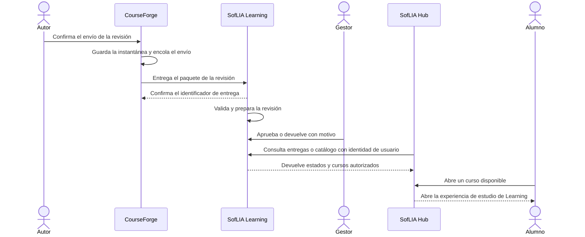

# Integración de cursos asíncronos de CourseForge con SofLIA Hub

**Estado** — Propuesta técnica para revisión.  
**Fecha** — 14 de noviembre de 2026.

## 1. Entendimiento del objetivo

Un autor crea un curso asíncrono en CourseForge y envía una versión a revisión. Un gestor puede seguir en Hub el estado de esa entrega, consultar qué debe corregirse y abrir la revisión en Learning. Cuando el curso se publica, un alumno con acceso puede encontrarlo en Hub y abrir la experiencia de estudio de Learning.

Se toma **asíncrono** como alcance principal de la solicitud. CourseForge ya tiene un flujo de preparación para sesiones síncronas programadas en Learning que se consumen en el aula de Hub. [Aula de sesiones de Learning](learning-live-workspace.md) · [Pruebas coordinadas del sistema síncrono](../operations/synchronous-testing-release.md)

**Recomendación** — CourseForge conserva la autoría, Learning valida y publica, y Hub muestra el estado confirmado de cada versión y da acceso al curso. Es la mejor opción para el objetivo actual porque cubre el seguimiento visible y el acceso del alumno aprovechando la revisión, el reproductor y el progreso que ya maneja Learning.

## 2. Diagnóstico técnico

| Producto | Comportamiento observado en el código | Trabajo pendiente |
| --- | --- | --- |
| CourseForge | Guarda una instantánea de la publicación en una cola persistente y responde HTTP 202. Un trabajador deposita el paquete en la bandeja `courseengine_inbox` y marca la solicitud `SENT`. | Vincular cada revisión con su confirmación en Learning y mostrar al autor qué corregir. |
| SofLIA Learning | Una tarea de Netlify configurada cada cinco minutos procesa la bandeja y deja el paquete en `courses_staging`. El gestor puede previsualizar, comparar, aprobar o rechazar. Learning tiene una vista de estudio por organización. | Exponer el estado de cada entrega con permisos y garantizar la integridad de la publicación. |
| SofLIA Hub | La agenda de sesiones síncronas ya consulta Learning con identidad de usuario y organización activa. | Añadir el seguimiento de entregas para gestores y el catálogo de asíncronos para alumnos. |

`SENT` confirma el depósito del paquete. `processed` confirma su procesamiento para revisión. Hub debe mostrar **Publicado** cuando Learning confirme que esa versión se publicó y consultar por separado el acceso del alumno.

| Hallazgo | Consecuencia | Tratamiento propuesto |
| --- | --- | --- |
| La bandeja y la búsqueda de cursos existentes usan el `slug`. | Una coincidencia puede vincular el envío al curso equivocado o reemplazar una entrega pendiente. | Usar organización, artefacto y revisión como identidad. Validar por separado el vínculo con un curso existente. |
| La recepción permite módulos como una lista de valores sin esquema interno. | Un paquete incompatible puede pasar a revisión y fallar durante la importación. | Validar la estructura completa antes de habilitar la revisión. |
| Si el importador no resuelve el instructor, puede elegir el primer usuario de la base. | El curso puede quedar atribuido a una persona ajena al curso o a la organización. | Exigir una identidad docente explícita, válida y autorizada. |
| La aprobación hace varias escrituras. El importador vincula módulos y lecciones por posición y elimina los obsoletos. | Un fallo puede dejar contenido parcial. Una reordenación puede cambiar el significado de un ID usado por el progreso. | Publicación atómica, piloto de cursos nuevos y preservación de IDs antes de habilitar actualizaciones. |

La revisión corresponde a los checkouts locales. La ejecución del cron en un entorno desplegado, la disponibilidad de medios y los permisos efectivos requieren comprobación en QA.

## 3. Alternativas y plan

| Alternativa | Experiencia desde Hub | Esfuerzo relativo | Cuándo elegirla |
| --- | --- | --- | --- |
| Acceso directo a Learning | El alumno abre el catálogo o curso. El gestor consulta el estado en Learning. | Bajo. Reutiliza la navegación y las interfaces existentes. | Si la prioridad es dar acceso al curso. |
| **Catálogo y seguimiento en Hub, estudio en Learning** | El gestor ve el estado, la versión, la fecha de confirmación y los motivos autorizados. El alumno abre sus cursos desde Hub. | Medio. Requiere un contrato de estado, controles de acceso y la vista en Hub. | **Para el objetivo actual.** Cubre acceso y seguimiento de la sincronización. |
| Estudio nativo en Hub | El alumno completa lecciones, materiales y evaluaciones en una interfaz nativa. Learning sigue gestionando el progreso. | Alto. Requiere contratos adicionales y pruebas de reproducción, evaluación, accesibilidad y progreso. | Si completar el curso en una vista nativa es un requisito confirmado. |

El piloto se limita a **cursos nuevos de una organización**, con confirmación explícita de envío y aprobación humana. Las actualizaciones de cursos con alumnos inscritos requieren pruebas de conservación del progreso.

1. **Learning** — Definir el contrato de recepción y consulta, la política de permisos y la publicación atómica. Reutilizar la revisión existente y vincularla a una versión inmutable.
2. **CourseForge** — Reutilizar la cola de salida. Guardar la confirmación de Learning y mostrar el avance y los motivos de devolución en el centro de publicación.
3. **Hub** — Implementar la consulta autorizada, la vista de entregas para gestores y el catálogo de alumnos. Reutilizar los patrones de identidad y navegación de Learning.
4. **QA** — Habilitar el piloto para una organización. Probar con identidades de autor, revisor y alumno antes de ampliar el acceso.

## 4. Implementación propuesta

### Envío y contratos

- **CourseForge** presenta **Enviar a revisión**, resume el contenido incluido y señala problemas junto al módulo o lección afectados. Al confirmar, guarda una versión inmutable. Los reintentos usan el mismo paquete.
- **Learning** recibe el paquete mediante una entrada de servidor autenticada con permiso acotado. Persiste la identidad de entrega antes de procesar el contenido en segundo plano. La vista previa y la aprobación identifican la misma revisión. Si quedó superada, Learning devuelve un conflicto y la interfaz recarga el detalle.
- **Hub** consulta Learning con la identidad del usuario. Electron main construye los destinos desde el origen configurado y valida las respuestas. La vista React accede mediante handler, allowlist de preload y wrapper tipado. Learning verifica la membresía y los permisos para cada recurso. [Estándar Electron e IPC](../standards/electron-ipc.md)

| Contrato propuesto | Datos e invariantes |
| --- | --- |
| Paquete | Versión del esquema, artefacto de origen, revisión, hash, datos del curso, módulos, lecciones y referencias a medios. El servidor verifica actor y organización. |
| Identidad de entrega | Organización de destino, ID estable del artefacto y revisión. La misma combinación con el mismo hash devuelve la confirmación previa. Un hash distinto para la misma revisión genera conflicto. |
| Estado de entrega | Identificador, revisión, estado, fecha, motivo accionable cuando corresponda y referencia estable al curso publicado. |
| Consulta de Hub | Listas paginadas y detalle por organización y permiso. La respuesta del catálogo omite el paquete original, las respuestas de las evaluaciones y los detalles internos. |

### Sincronización visible

| Estado | Qué confirma el sistema | Acción disponible |
| --- | --- | --- |
| **En cola** | CourseForge guardó la solicitud. | Consultar el envío en CourseForge. |
| **Recibido** | Learning registró la revisión. | Consultar el identificador de entrega. |
| **En revisión** | Learning completó la validación y preparó la vista previa. | Abrir la revisión en Learning con el permiso correspondiente. |
| **Requiere cambios** | Learning detectó un problema de contenido o el revisor devolvió el paquete. | Consultar el motivo, corregir en CourseForge y enviar una nueva revisión. |
| **Publicado** | Learning confirmó la publicación de esa revisión. | Abrir el curso si el usuario tiene acceso. |
| **Error temporal** | El servidor registró un fallo recuperable. | Consultar el siguiente intento o reintentar la misma entrega cuando corresponda. |

Cuando Hub no puede consultar Learning, presenta **Pendiente de confirmación** junto al último estado verificado, su fecha y la acción **Actualizar**. En el piloto, Hub observa las entregas desde **Recibido**. Mostrar **En cola** en Hub requeriría consultar las solicitudes que todavía viven en CourseForge.

El gestor ve el título, la revisión enviada, la última revisión publicada, el motivo autorizado y el identificador de entrega. Por ejemplo, la versión 3 puede mostrarse **En revisión** mientras la versión 2 sigue **Publicada**. El alumno ve sus cursos disponibles y la acción **Abrir curso**. Learning vuelve a verificar el acceso al entrar.

### Validación, seguridad y recuperación

| Frontera | Controles |
| --- | --- |
| CourseForge | Validar permiso de envío sobre el artefacto y organización activa. Revisar la selección de lecciones, la modalidad, las referencias y los medios requeridos antes de confirmar. |
| Recepción en Learning | Autenticar la integración. Verificar tamaño, versión de esquema, hash, actor, organización e instructor autorizado. Validar módulos, lecciones, materiales, actividades, evaluaciones y política de acceso a medios. |
| Revisión y publicación | Comprobar el permiso sobre la organización y el curso. Aprobar solo la revisión inspeccionada. Confirmar la publicación y activar el contenido con una transición atómica para las escrituras académicas. Validar los medios antes de activar. |
| Hub | Validar solicitudes y respuestas. Acotar resultados a la identidad y organización activas. Cancelar o descartar respuestas pendientes al cambiar de organización o cerrar sesión. |
| Reintentos | Aplicar tiempos de espera y reintentos acotados con espera incremental en fallos transitorios. Consultar por la identidad de entrega si se pierde la respuesta. Los errores de datos y permisos requieren corrección. |

Registrar el identificador de entrega para correlacionar envío, procesamiento y aprobación. Medir tiempo en cola, tiempo hasta revisión y fallos por categoría. Mantener credenciales, URLs firmadas y contenido del curso fuera de los registros. Actualizar el estado al abrir la vista o bajo demanda y paginar los listados. Fijar objetivos de latencia y capacidad con mediciones del piloto.

## 5. Riesgos y criterios de aceptación

| Escenario | Resultado esperado |
| --- | --- |
| Autor envía un curso válido y el gestor lo aprueba. | Hub muestra **Publicado** tras la confirmación y el alumno autorizado abre el curso. |
| Un medio obligatorio es inaccesible o una actividad tiene formato incompatible. | Learning identifica el elemento afectado y la revisión queda fuera del catálogo. |
| El revisor devuelve el curso. | Los usuarios autorizados ven el motivo y el autor puede enviar una revisión nueva. |
| CourseForge pierde la respuesta después del registro en Learning. | El reintento recupera el mismo identificador y conserva el avance. |
| Dos organizaciones usan el mismo slug o un usuario intenta leer una entrega ajena. | Las entregas se mantienen independientes y se deniega la consulta no autorizada. |
| Dos gestores aprueban a la vez o alguien aprueba una revisión superada. | Existe una sola transición válida. La otra solicitud recupera el resultado o recibe un conflicto. |
| Falla una escritura durante la aprobación. | Ningún curso parcial aparece en el catálogo y la entrega queda recuperable. |
| Hub pierde conexión o el usuario cambia de organización durante una consulta. | Hub muestra el último dato confirmado en el contexto correcto y descarta respuestas obsoletas. |
| Un alumno sin acceso intenta abrir un curso publicado. | Learning deniega el acceso. |

Antes de habilitar actualizaciones, comprobar en QA la conservación de IDs, respuestas, historial y reanudación al reordenar, sustituir o retirar lecciones de cursos con alumnos inscritos. Si se necesita revertir el piloto, deshabilitar nuevas entregas y la vista piloto por organización. Conservar los registros para reconciliación y gestionar los cursos ya publicados desde Learning.

## 6. Mejoras y decisiones pendientes

- **Estudio nativo** — Acordar si completar el curso dentro de una vista nativa de Hub es un requisito. De serlo, definir el alcance del reproductor, evaluación, progreso y accesibilidad antes de implementarlo.
- **Avisos** — Añadir notificaciones de aprobación o rechazo si el seguimiento bajo demanda no cubre la operación de los gestores.
- **Actualizaciones** — Definir qué puede editarse en cursos publicados, cómo conservar el progreso y qué sucede con lecciones retiradas.

## Evidencia de la revisión

Los paths de CourseForge y Learning son relativos a sus repositorios. Las revisiones corresponden al HEAD local observado durante el análisis.

| Repositorio | Revisión | Referencias |
| --- | --- | --- |
| CourseForge | `3683f20f` | `apps/web/src/app/api/publish/route.ts`, `apps/web/src/domains/publication/publication-outbox.service.ts`, `apps/web/src/domains/course-delivery/services/delivery-live.ts` |
| SofLIA Learning | `f918c4560` | `netlify.toml`, `apps/web/src/app/api/cron/process-inbox/route.ts`, `apps/web/src/features/admin/actions/admin-courses/staging-details.service.ts`, `apps/web/src/features/admin/actions/admin-courses/approve-course.service.ts`, `apps/web/src/lib/course-import/instructors.ts`, `apps/web/src/lib/course-import/apply-payload.ts`, `apps/web/src/app/[orgSlug]/courses/[slug]/learn/page.tsx` |
| SofLIA Hub | `0a10deaa` | [Catálogo autenticado de Learning](../../electron/learning-live-catalog.ts), [aula de sesiones](learning-live-workspace.md), [diccionario de datos](../data/data-dictionary.md) |

El análisis fue estático. La verificación funcional del flujo, sus permisos en un entorno desplegado y el rendimiento corresponden al piloto.
