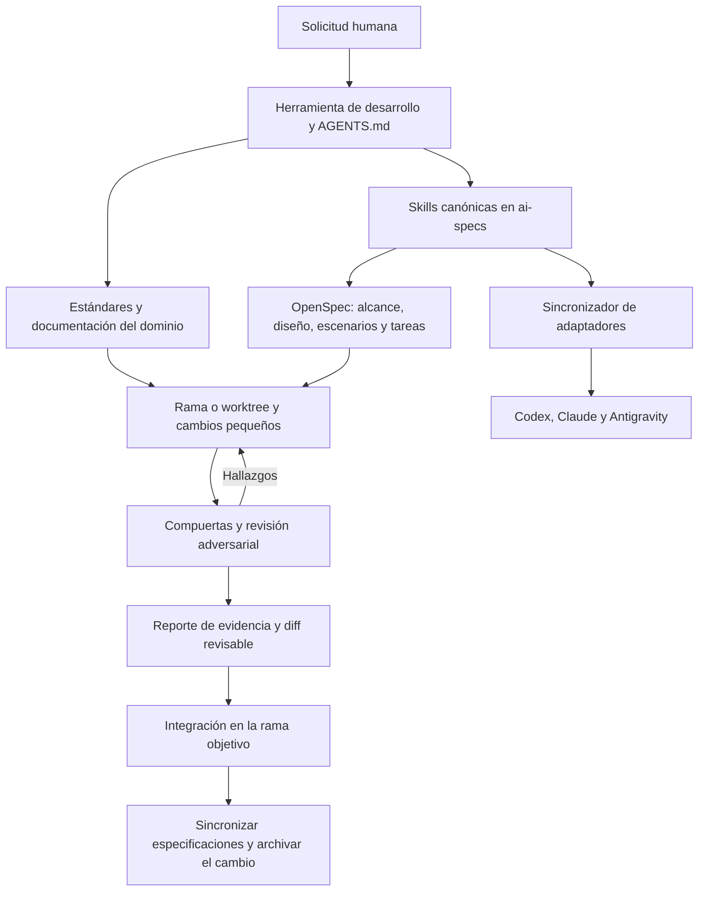

# Arquitectura del arnés de desarrollo

Estado: vigente. Actualizado: 2026-10-15.

<!-- evidence: AGENTS.md -->
<!-- evidence: ai-specs/README.md -->
<!-- evidence: ai-specs/agents/registry.yaml -->
<!-- evidence: scripts/ai/sync-agent-adapters.mjs -->
<!-- evidence: scripts/quality/validate-harness.mjs -->
<!-- evidence: scripts/quality/run-gate.mjs -->
<!-- evidence: openspec/config.yaml -->
<!-- evidence: .github/workflows/ci.yml -->

## Qué es y para qué sirve

El arnés es la estructura que rodea al agente que modifica este repositorio:
le proporciona contexto, procedimientos, herramientas, estado durable y
verificación. Se implementa mediante archivos versionados, scripts y CI.
El modelo y su aplicación de desarrollo ejecutan el trabajo; el arnés define
cómo orientarlo, revisarlo y conservar evidencia.

El problema original, confirmado en el [diseño fundacional](../../openspec/changes/implement-soflia-harness/design.md),
era la acumulación de instrucciones divergentes por herramienta, documentación
desordenada, archivos generados versionados y scripts desalineados con el código.
El arnés permite que otra persona o agente retome una tarea sin depender de una
conversación anterior y que una entrega se evalúe con verificaciones repetibles.
No garantiza por sí solo la calidad de una decisión ni sustituye permisos del host.

Para replicar este flujo en otro sistema, seguir la
[guía de portabilidad](../operations/port-harness-to-another-system.md).

## Procedencia confirmada y evolución

La fuente externa registrada es **LIDR Academy / lidr-specboot**, junto con el
PDF «Resumen - Arnes.pdf». El [registro de fuentes](../references/harness-sources.md)
conserva el commit externo, las fechas, los elementos adoptados y las limitaciones
de la atribución. SofLIA es una adaptación al proyecto, no una importación íntegra
del repositorio externo.

El historial Git local permite reconstruir estas etapas:

| Fecha | Commit local | Cambio verificable |
| --- | --- | --- |
| 2026-07-21 | `dcf3125` | Fundación: router, skills, políticas, OpenSpec, scripts y CI. |
| 2026-07-21 | `2a97251` | Adaptación a Antigravity, retiro de Cursor/Gemini CLI y catálogo documental. |
| 2026-07-21 | `cab11b0` | Recuperación del estándar maestro de ingeniería y su alias. |
| 2026-09-22 | `8f0ff22` | Incorporación posterior del arnés runtime supervisado para reuniones. |
| 2026-09-23 | `850b5a3` | Extensión de equipos runtime a varias superficies del producto. |

Se pueden consultar con `git show <commit>` desde este repositorio. Las decisiones
de las primeras etapas están en los cambios
[fundacional](../../openspec/changes/implement-soflia-harness/design.md) y de
[adaptación](../../openspec/changes/adapt-harness-and-document-system/design.md).
Esta descripción se contrastó con el árbol local del 2026-10-15 sobre base
`f0b18bca3948aa8157f8cc9e4a8d3fdaa2036da9`; había cambios de trabajo adicionales.

## Los cinco componentes en SofLIA

| Componente | Implementación actual | Responsabilidad |
| --- | --- | --- |
| Instrucciones | [AGENTS.md](../../AGENTS.md), [estándares](../standards/engineering-practices.md), [skills](../../ai-specs/skills) | Cargar reglas del dominio y procedimientos relevantes. |
| Herramientas | Herramientas del agente anfitrión, Git y [scripts npm](../../package.json) | Leer, cambiar y comprobar dentro del alcance autorizado. |
| Entorno | Repositorio, lockfile, Node, Electron, Python y configuraciones de pruebas | Reproducir el entorno de desarrollo propio del producto. |
| Estado | [OpenSpec](../../openspec/config.yaml), Git y [plantillas](../../ai-specs/templates) | Conservar alcance, decisiones, tareas, implementación y resultados. |
| Retroalimentación | [compuertas](../../scripts/quality/run-gate.mjs), pruebas y revisión adversarial | Detectar errores y devolver evidencia para corregir. |

La lista es conceptual: no existe un proceso central que cargue y ejecute
automáticamente estos cinco componentes.

## Flujo y dependencias

El flujo se coordina mediante instrucciones y workflows. CI ejecuta comprobaciones;
no demuestra automáticamente que el agente haya enriquecido la solicitud, usado
un worktree o realizado una revisión adversarial efectiva.

### Contexto canónico y adaptadores

[AGENTS.md](../../AGENTS.md) es el router: carga los estándares base, ingeniería,
la guía del área, el cambio activo y la skill correspondiente. Los documentos
extensos se mantienen en `docs/`, los procedimientos en `ai-specs/skills/` y el
estado de cada entrega en `openspec/changes/`.

[CLAUDE.md](../../CLAUDE.md) y [codex.md](../../codex.md) remiten al router.
Antigravity añade la [regla del workspace](../../.agents/rules/soflia-harness.md)
y los [workflows OpenSpec](../../.agents/workflows). El alias
[prompt_maestro.md](../prompt_maestro.md) remite al estándar maestro.

El [sincronizador](../../scripts/ai/sync-agent-adapters.mjs) recorre las skills
canónicas y genera wrappers en `.codex/skills/`, `.claude/skills/` y
`.agents/skills/`. Cada wrapper conserva `name` y `description`, calcula la ruta
relativa y pide leer el `SKILL.md` original. Son archivos ordinarios: se evitó
depender de enlaces simbólicos por compatibilidad con Windows/OneDrive.

`adapters:check` compara el contenido esperado con el generado. El sincronizador
no elimina wrappers huérfanos al retirar o renombrar una skill, ni sincroniza
automáticamente sus recursos auxiliares o metadatos `agents/openai.yaml`.
Esos casos requieren revisión explícita.

### Roles, procedimientos y políticas

El [registro](../../ai-specs/agents/registry.yaml) relaciona responsabilidades de
desarrollo con skills: análisis, ingeniería Electron, datos/seguridad,
verificación y entrega. Como explica su [README](../../ai-specs/agents/README.md),
un rol no equivale a un proceso autónomo ni obliga a crear subagentes.

Las skills canónicas cubren enriquecimiento, worktrees, IPC, migraciones,
verificación, revisión adversarial, documentación, entrega, presentaciones y
producción audiovisual. El inventario real se obtiene de `ai-specs/skills/`;
los comandos OpenSpec específicos también tienen sus propios adaptadores.

Las [políticas de herramientas](../../ai-specs/policies/tool-boundaries.md) y de
[exposición runtime](../../ai-specs/policies/runtime-exposure.md) definen límites.
Son instrucciones documentales: la aplicación anfitriona debe aplicar sus propios
permisos. El YAML de roles no actúa como un sistema ejecutable de autorización.

### Memoria del cambio

Cada cambio material conserva propuesta, diseño, requisitos y tareas en OpenSpec;
puede incorporar un paquete de contexto y reportes de evidencia. Las
[plantillas](../../ai-specs/templates) definen objetivo, alcance, restricciones,
criterios, incertidumbres, comandos ejecutados y resultados.

[openspec/config.yaml](../../openspec/config.yaml) aporta contexto y reglas por
artefacto. Git conserva código y commits; los worktrees permiten aislamiento;
la conversación aporta contexto temporal. Son responsabilidades complementarias.
El ciclo operativo y el momento de archivar se detallan en la
[guía rápida](../operations/harness-quickstart.md).

### Verificación ejecutable y CI

La secuencia actual de `verify:pr` proviene de
[run-gate.mjs](../../scripts/quality/run-gate.mjs) y se detiene en el primer fallo:

1. `adapters:check`: correspondencia de wrappers.
2. `harness:validate`: estructura e invariantes del arnés.
3. `audit:supply-chain`: controles de dependencias definidos por el proyecto.
4. `docs:system:check`: catálogo, evidencia, IDs e inventarios derivados.
5. `docs:check`: existencia de destinos de enlaces Markdown locales.
6. `skills:seed:check`: coherencia del catálogo de Skills del producto.
7. `openspec:validate`: validación estricta de las especificaciones.
8. `typecheck`: contratos TypeScript de renderer y main.
9. `lint:changed`: incidencias nuevas respecto a la línea base.
10. `test`: suite Vitest.

`verify:release` añade estabilidad de Electron y build/empaquetado. Las Skills del
paso 6 pertenecen al producto; ese paso es una especialización de SofLIA, no un
requisito universal de un arnés de desarrollo.

[validate-harness.mjs](../../scripts/quality/validate-harness.mjs) comprueba rutas
obligatorias, referencias al router/estándar, secciones del estándar, formato de
skills, fuentes del registro, declaración vacía de exposición de skills de
desarrollo y artefactos vetados. También impide la reaparición de adaptadores
retirados. No evalúa la calidad semántica de una instrucción o de un requisito.
La correspondencia exacta de wrappers se comprueba por separado.

[lint-changed.mjs](../../scripts/quality/lint-changed.mjs) reúne archivos del diff,
índice y archivos nuevos. `HARNESS_BASE_REF` puede ampliar la selección al diff
de la rama; las incidencias se comparan con `HEAD` por regla y severidad.
Este control evita aumentos en el conteo de incidencias, pero puede omitir una
incidencia nueva si desaparece otra de la misma regla. No certifica ausencia de
deuda ni sustituye el lint completo.

El [workflow de CI](../../.github/workflows/ci.yml) corre en PR y ejecución manual,
usa Ubuntu, Node 24, `npm ci`, historial completo y `verify:pr`. Su variable
`HARNESS_BASE_REF` toma la base del PR. Que estas verificaciones sean obligatorias
para fusionar depende además de la protección remota de ramas, no comprobada aquí.

## Frontera con el arnés runtime

| Aspecto | Desarrollo | Runtime del producto |
| --- | --- | --- |
| Objetivo | Modificar el sistema bajo Git. | Resolver encargos dentro de Soflia Hub. |
| Estado | OpenSpec, Git y reportes. | Ejecuciones, aportes y artefactos del usuario. |
| Herramientas | Las autorizadas al agente anfitrión. | Catálogos tipados y guardas del canal/host. |
| Permisos | Usuario y entorno de desarrollo. | Identidad, organización, contexto y HITL. |
| Implementación | Markdown, YAML, scripts y CI. | Servicios TypeScript y proveedores de modelos. |

El [manual runtime](runtime-agents-manual.md) y el
[contrato multiagente](runtime-multiagent-harness.md) son las fuentes canónicas de
ese segundo plano. Actualmente hay tres rutas principales:

- **Preparación breve**: [policy.ts](../../src/shared/agent-teams/policy.ts)
  selecciona roles y límites;
  [runner.ts](../../src/shared/agent-teams/runner.ts) recibe una función `generate`,
  ejecuta especialistas sin herramientas y entrega aportes al coordinador del
  canal. El estado es efímero y el límite de concurrencia es por proceso.
- **Reuniones supervisadas**: [agent-runtime](../../electron/agent-runtime)
  coordina acuerdos, evidencia y minuta con catálogo de lectura, identidad,
  repositorio cifrado y aprobación para crear un borrador. Admite Gemini y el
  [adaptador local Codex](../../electron/codex-runtime).
- **Trabajos ejecutores**: [background-teams](../../electron/background-teams)
  incorpora herramientas acotadas, artefactos, persistencia y recuperación.
  Sus [contratos](../../src/shared/background-teams.ts) difieren de los equipos
  efímeros. Cambiar de chat no cancela un trabajo admitido.

Estos módulos no cargan `ai-specs/skills/` para otorgar capacidades. El repositorio
externo Specboot explica la procedencia del flujo de desarrollo; no basta para
atribuirle la implementación de estos servicios runtime.

## Límites de esta arquitectura

- La carga de reglas depende del cliente de desarrollo y del uso correcto del router.
- Las verificaciones estructurales no prueban cumplimiento semántico ni eliminan
  alucinaciones; la revisión de evidencia sigue siendo necesaria.
- OpenSpec registra estado, pero no ejecuta automáticamente tareas o herramientas.
- Los validadores incluyen supuestos concretos de SofLIA: rutas, adaptadores,
  catálogo IPC, paleta y Skills del producto. Deben adaptarse antes de reutilizarlos.
- Copiar documentación no traslada permisos, CI remoto, dependencias ni credenciales.
- Esta revisión documenta el árbol local; la adopción en otro sistema todavía
  necesita conocer su stack, sus comandos y sus fronteras de autorización.

Las comprobaciones y brechas de esta entrega se conservan en la
[evidencia de revisión documental](../reports/harness-documentation-2026-10-15.md).
