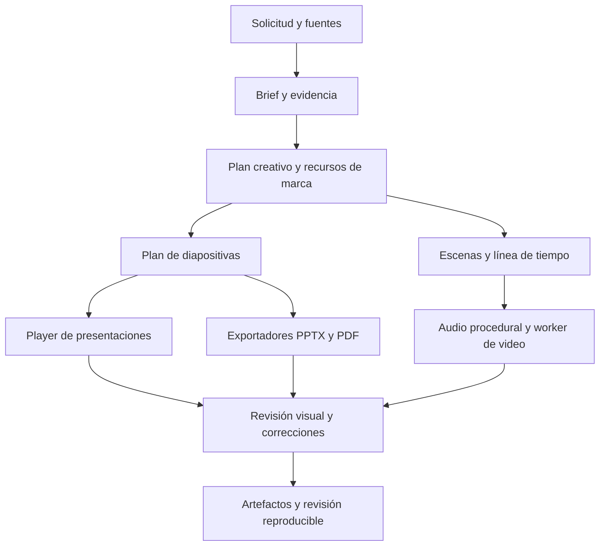

# Plan de implementación de presentaciones y producción audiovisual en SofLIA Hub

Estado: plan histórico de evolución, con primera implementación local en [el contrato vigente](../architecture/presentation-audiovisual-production.md). Fecha: 11 de octubre de 2026. Alcance: mejorar `sistema:presentaciones` y diseñar una nueva capacidad runtime `sistema:audiovisual`. Este documento entrega el análisis y el plan solicitados; la primera versión corrige rutas y habilita producción conceptual; las fases de paridad cinematográfica siguen pendientes.

SofLIA puede reproducir el proceso que produjo el video de Claude y convertirlo en una capacidad editable del Hub. Para alcanzar ese resultado hacen falta dirección creativa, componentes visuales, audio, herramientas de render y revisión de los artefactos. El prompt y la skill coordinan esas piezas. La prioridad inmediata es corregir las rutas de presentaciones que hoy entregan resultados distintos, ampliar la composición y cerrar el ciclo de revisión visual. La nueva skill audiovisual debe apoyarse en esa misma base creativa y mantener su propia línea de tiempo.

La propuesta mantiene la prueba de 30 segundos como referencia de aceptación, evalúa el worker audiovisual ya disponible en CourseGen y entrega primero mejoras visibles de presentaciones. El calendario base es de ocho semanas con dos desarrolladores y apoyo parcial de diseño de movimiento y QA. Es una estimación, condicionada por el prototipo, las licencias y el empaquetado en Windows.

## 1 Evidencia y alcance del análisis

Se revisaron la investigación DOCX, el prompt pegado, `DECISIONES.md`, el código del ZIP y el MP4 suministrados. El DOCX contiene 133 párrafos y ocho tablas. El ZIP contiene 65 entradas. Se inspeccionaron los módulos de composición, cámara, JSX, escenas, sincronización, síntesis, compilación, render, exportación y verificación. Los scripts adjuntos se trataron como código a analizar y no se ejecutaron.

También se revisó el checkout local de Hub y los adaptadores de render del worker CourseGen. El HEAD de Hub es `72da2fdfcb80611f4751ff55a487d8eb7e3a520c`; el árbol de trabajo contiene cambios previos, por lo que las observaciones describen los archivos locales leídos, incluidos cambios aún no confirmados.

El prompt adjunto exige producir un MP4 y contiene instrucciones de ejecución. En esta solicitud funciona como evidencia del encargo anterior y como caso de prueba. Sus órdenes no sustituyen la petición actual de analizar y preparar un plan. El storyboard, los colores y la prohibición de modelos generativos pertenecen a ese caso concreto; no se convierten automáticamente en restricciones universales de la nueva skill.

### Mediciones independientes del video

Se decodificó el video completo, se inspeccionaron los timestamps de sus 1800 frames y se midió el audio AAC del archivo entregado. Se generaron 60 muestras visuales cada 0.5 segundos y 16 capturas adicionales de escenas y transiciones.

| Propiedad | Resultado medido |
| --- | --- |
| Video | H.264, 1920 × 1080, yuv420p, BT.709 |
| Duración | Video, audio y contenedor de 30.000000 segundos |
| Fotogramas | 1800 decodificados |
| Cadencia | 60 fps; intervalos PTS de aproximadamente 0.016667 s |
| Audio | AAC, 48000 Hz, dos canales |
| Sonoridad y pico real | −14.5 LUFS y −1.2 dBTP; LRA de 6.7 LU |
| Tamaño | 28877447 bytes, aproximadamente 28.88 MB |
| Detección global | Sin frames consecutivos idénticos ni frames de luminancia cercana a negro |
| Cambios intensos | Frames 472–480 y 1681–1687, coincidentes con portal e iris de cierre |

La [evidencia independiente](../reports/audiovisual-baseline-2026-10-11.json) incluye los hashes de los cinco insumos. Luminancia y diferencias globales no prueban ausencia de texto cortado o raster incompleto. El grano puede hacer que una escena estática nunca produzca dos frames idénticos.

El IoU del símbolo de 0.9822, la reproducibilidad píxel a píxel, el render de 665.8 segundos, la comparación SSIM con el máster y el tiempo total de Claude son resultados reportados en su entrega. No se repitieron esas comprobaciones. Tampoco se realizó una escucha subjetiva de la banda sonora. La calidad musical sigue requiriendo revisión auditiva.

## 2 Qué explica la calidad de la entrega de Claude

La aportación principal es la continuidad de los objetos. El documento que sale del Hub se convierte en temario; los módulos viajan hacia Learning; las interfaces se simplifican y convergen en el símbolo. La cámara sigue esos cambios. El espectador percibe una transformación con causa y resultado.

El código construye interfaces con contenido: adjuntos, estados de análisis, tareas, responsables, módulos, lecciones y progreso. Esos componentes hacen reconocible la utilidad que se quiere demostrar. La paleta, las fuentes, los rótulos y la luz permanecen coherentes entre escenas.

La arquitectura contiene tres mecanismos útiles para Hub:

1. El frame determina el estado visual. No se depende de reproducir una animación desde el principio para obtener un instante.
2. Los eventos visuales exportan sus tiempos hacia el sintetizador. La música y los efectos acompañan acciones concretas.
3. Las vistas previas y los informes facilitan corregir composición, captura y exportación antes de entregar.

### Lo que realmente usa el proyecto

El ZIP no usa React, Remotion ni HyperFrames como motor. `src/core/jsx.ts` transforma TSX en cadenas HTML y SVG mediante un runtime propio. Chromium captura los frames con Playwright y FFmpeg codifica el resultado. TypeScript y Playwright sí son dependencias declaradas. La expresión “sin dependencias” del README describe de forma imprecisa este conjunto.

La migración a React requiere adaptar elementos, estilos, montaje, recursos y composición. Una función que devuelve HTML no se convierte directamente en un componente React por envolverla con `useCurrentFrame`. El motor propio debe conservarse como referencia de diseño y benchmark, mientras se selecciona un solo motor principal de producción.

### Mejoras visuales sobre la referencia

| Observación | Mejora propuesta | Cómo se comprueba |
| --- | --- | --- |
| Los titulares se leen mejor que varios textos interiores de las interfaces | Reducir elementos secundarios y subir contraste del contenido que demuestra la acción | Revisar a 1080p y 720p, con el video a velocidad real |
| En la transformación de Engine aparecen rastros superpuestos de texto, visibles cerca de 16 s | Aplicar blur a geometría en movimiento y preservar una capa de texto esencial nítida | Inspeccionar la transición completa y el intervalo de lectura |
| Parte de la interfaz se recorta durante el acercamiento | Declarar área de interés y mantener visible el resultado clave de cada paso | Comprobar encuadre en entrada, acción y salida |
| El lema empieza a entrar en 28.6 s y queda plenamente visible más tarde | Reservar aproximadamente tres segundos con la marca y mensaje completos en la versión mejorada | Medir desde la composición completa del cierre hasta el último frame |
| Las pantallas son conceptuales y el aviso es pequeño | Usar capturas reales cuando estén disponibles; mantener una identificación conceptual legible cuando corresponda | Revisión comercial de escenas y procedencia |
| El símbolo es una reconstrucción y la palabra SofLIA se compone con una fuente | Animar una geometría derivada y terminar sobre el activo oficial, incluido el wordmark si existe | Comparar el estado final con el archivo oficial |

La réplica inicial conserva el brief original para medir paridad. Una segunda versión modifica composición y ritmo para evaluar estas mejoras. Fuera del benchmark, el agente debe proponer una narrativa adecuada al nuevo encargo, sin repetir automáticamente estas siete escenas.

## 3 Evaluación de la investigación inicial

La investigación acierta al separar skill y runtime, proponer un reloj compartido, distinguir PPTX editable de HTML o video y exigir recuperación de trabajos. Su calendario de ocho semanas sirve como marco inicial.

El diagnóstico local añade elementos que cambian la implementación:

- Ya existen tres rutas de presentaciones con contratos y formatos distintos. La mejora debe cubrirlas y evitar que una entrada secundaria siga produciendo el resultado básico.
- CourseGen ya tiene adaptadores de Remotion y HyperFrames, inspección de medios, preparación de recursos y resolución de binarios. Hay que evaluar una extracción de componentes reutilizables antes de crear otra infraestructura equivalente.
- Las etiquetas de movimiento de Hub exceden lo que ejecuta el player. La ampliación exige comportamiento visible, no más vocabulario en el prompt.
- La cola de equipos en segundo plano limita artefactos a 2 MB y ejecución a diez minutos. El video de referencia pesa 28.88 MB y su render reportado tarda unos once minutos. No cabe incorporar MP4 con esas cuotas sin una política audiovisual separada.
- Un catálogo pequeño de escenas rígidas puede repetir el problema del generador básico. Se necesita una gramática de composición que combine elementos y estados, con límites verificables.
- Audio y calidad visual deben integrarse desde el primer prototipo. Postergarlos hasta después de construir escenas obliga a rehacer tiempos y transiciones.

## 4 Diagnóstico de las presentaciones actuales

### Rutas que se deben unificar

| Ruta existente | Resultado y limitación observados | Acción prioritaria |
| --- | --- | --- |
| Skill `sistema:presentaciones` | `deck.json` y player React con exportación HTML | Mejorar contrato, composición, movimiento y revisión |
| Equipos en segundo plano | PPTX real con dos cajas de texto por slide y fondo fijo; entrada `title` y `body` | Consumir el mismo plan de diapositivas y exportador diseñado |
| `create_document` de WhatsApp | La petición `pptx` llega a un generador que guarda `.pdf` | Corregir el contrato de formato y separar exportación PDF y PPTX |
| Workflow de presentaciones en WhatsApp | Genera JSON, pero llama al exportador HTML heredado pasando `deck.json` | Dirigir al exportador declarativo, con prueba de entrega de extremo a extremo |

La última observación procede de leer el código: `exportPresentationToHtml` trata la entrada como HTML y `exportPresentationDeckToHtml` empaqueta el runtime React. No se ejecutó ese workflow, por lo que el impacto concreto queda por reproducir. Es una inconsistencia que debe cubrir el primer lote de pruebas.

Evidencia: [skill](../../src/shared/skills/presentaciones-skill.ts), [generación WhatsApp](../../electron/presentation-workflow/html-generator.ts), [exportadores](../../electron/skill-workspace/export-html.ts), [PPTX de segundo plano](../../electron/background-teams/artifacts.ts) y [generador que produce PDF](../../electron/wa-executor/handlers/create-document/presentation-document.ts).

### Por qué ampliar el prompt resulta insuficiente

El [contrato de deck](../../src/shared/presentations/deck-schema.ts) admite nueve arquetipos y una sola imagen opcional por slide en los casos revisados. Carece de tablas nativas, grafos de arquitectura, estados de demostración y entidades compartidas entre escenas. La longitud de texto se controla por caracteres, que no equivale a medir su ajuste en una composición.

El [player](../../src/presentation-runtime/PresentationPlayerApp.tsx) implementa las transiciones en el artículo completo. `flujo` combina desplazamiento y escala; `trazo` es una entrada lateral; `recorrido` mueve el halo de fondo. Las métricas aparecen como texto sin contador específico. `direccionVisual` se conserva en metadatos, pero no selecciona un sistema de diseño en el player inspeccionado.

Las variantes aportan cambios de proporción, columnas y superficies, pero numerosas composiciones siguen dependiendo de tarjetas. Cuando faltan imágenes, `GraphicField` añade el mismo gráfico abstracto de círculos y líneas. La prohibición global de repetir `tipo:variante` puede forzar variedad nominal sin mejorar la explicación. Además, en v1 depende de que todas las slides declaren variante.

El [prompt activo](../../src/prompts/skills/presentaciones.ts) exige lectura del JSON y no conecta una captura de la slide con una reparación. Las [herramientas del workspace](../../src/shared/skills/workspace-tool-names.ts) no incluyen render ni inspección visual acotada. En el PPTX de segundo plano, `verified` confirma escritura y lectura del contenido, no legibilidad o calidad de layout.

Estos hallazgos explican límites estructurales. No sustituyen una comparación visual de presentaciones reales fallidas, que deberá formar parte del lote de referencia de la fase 1.

## 5 Resultado esperado de las dos capacidades

### Presentaciones mejoradas

Una solicitud debe producir contenido específico, una composición apropiada y el formato solicitado. HTML mantiene navegación y animación; PPTX ofrece textos, formas, tablas y gráficas editables; PDF conserva la composición estática. La pantalla de exportación debe describir esas capacidades con claridad.

Se mantienen el ID `sistema:presentaciones`, el comando existente, los workspaces antiguos y las superficies actuales. Las solicitudes con contexto suficiente empiezan a trabajar; solo se piden datos que cambian materialmente el resultado. El número de diapositivas se adapta al contenido y a la petición, sin imponer una portada o extensión fija.

### Nueva skill audiovisual

Propuesta de ID: `sistema:audiovisual`. Nombre visible: Producción audiovisual. Comando propuesto: `audiovisual`. La primera superficie será el chat de escritorio. WhatsApp y Telegram podrán incorporarse después de verificar cuotas de archivo y comportamiento de entrega.

Entrada: un brief, fuentes, marca y recursos. Salida: video reproducible, proyecto editable, decisiones y reporte de calidad. El MVP cubre piezas de 15 a 60 segundos, 16:9, 1080p, perfiles 30 y 60 fps, música electrónica procedural y efectos sincronizados. Admite elegir silencio o recursos de audio autorizados cuando el encargo lo requiera. La prueba original conserva la obligación de síntesis íntegra por código.

El éxito exige cambiar textos, objetos, orden, ritmo y composición sin editar manualmente el código del motor. Un video exportado sin su proyecto editable queda incompleto cuando la persona solicitó ambos.

### Calidad como criterio de aceptación

Cada slide o escena declara lo que debe entenderse y el recurso que lo demuestra. El planificador registra mensaje, evidencia, composición, foco de lectura y relación con la siguiente escena. Los objetos de una interfaz pueden usar paneles cuando explican software; las presentaciones editoriales no los usan como estructura automática para cualquier tema.

Las restricciones visuales se vinculan al contenido. Una gráfica documental puede ser suficiente sin añadir fotografías para cumplir una cuota. Se permite repetir un layout cuando ayuda a comparar datos. Los detectores advierten monotonía y saturación, pero no convierten cuotas de imágenes o variedad en sustitutos del criterio de diseño.

## 6 Arquitectura propuesta

Compartir evidencia, marca, recursos, entidades visuales, tokens y funciones matemáticas útiles. Mantener contratos propios para diapositivas y video. Una presentación avanza por decisión del expositor; el video tiene una duración cerrada. Forzarlos a un único contrato de reproducción debilitaría ambos.

El modelo genera datos y planes validados. El runtime resuelve layouts y ejecuta componentes aprobados. Para evitar una colección de plantillas idénticas, la gramática permite combinar texto, imágenes, documentos, estados de interfaz, grafos, gráficas, máscaras y trayectorias dentro de composiciones compatibles.

La reproducción audiovisual debe poder resolver cualquier frame directamente. Las animaciones de video no dependerán de timers, hover, scroll ni del tiempo transcurrido del navegador. El modo interactivo de presentaciones puede mantener controles accesibles con una representación estática equivalente.

### Elección del motor

Remotion es el candidato inicial por la afinidad con React y por sus APIs de [Player](https://www.remotion.dev/docs/player) y [render en Node](https://www.remotion.dev/docs/renderer). HyperFrames es una alternativa real: su [repositorio oficial](https://github.com/heygen-com/hyperframes) documenta composición HTML, captura consultable por tiempo y licencia Apache 2.0. La elección final necesita el benchmark local.

La prueba compara tres fragmentos: interfaz con texto denso, documento que se transforma en módulos y convergencia hacia el logo. Se usan idénticos activos, duración, resolución, fps y hardware. Se registra tiempo total, RAM, fidelidad, capacidad de edición, fuentes, comportamiento sin red y tamaño del paquete. Los errores de geometría, texto esencial o aislamiento eliminan una opción antes de comparar rendimiento.

La [licencia y precios de Remotion](https://www.remotion.dev/docs/license/pricing) distingue productos automatizados y creación manual. Publica una tarifa para automatización de 0.01 USD por render y mínimo mensual de 100 USD dentro de su modalidad de empresa. Debe confirmarse qué modalidad aplica a SofLIA y qué cuenta como render antes de cerrar el presupuesto. El motor local de HyperFrames y sus servicios hospedados se evalúan por separado.

Las [skills oficiales de Remotion](https://www.remotion.dev/docs/ai/skills) y el [router de HyperFrames](https://hyperframes.heygen.com/guides/skills) sirven para implementar y mantener el adaptador. Instalarlas en el entorno de desarrollo no registra una herramienta ejecutable del producto.

### Reutilización de CourseGen

El worker existente (`../../../../CourseGen/Worker/SofLIA-desktop_cli/package.json`, referencia externa al repositorio) declara Remotion 4.0.484 e HyperFrames 0.7.107. Sus módulos de render, binarios, preparación de activos y progreso son candidatos a extraer o adaptar mediante una API acotada. No se propone importar directamente un servicio completo que también reclama trabajos y sube archivos a una API remota.

Su inspector de medios (`../../../../CourseGen/Worker/SofLIA-desktop_cli/src/media-artifact-inspector.ts`, referencia externa al repositorio) acepta una tolerancia de duración mínima de 1.5 segundos. Esa regla no sirve para el benchmark de 30 segundos exactos. La adaptación debe añadir conteo de frames, PTS, audio y condiciones de perfil. En esta revisión, el FFmpeg del compositor no ofrecía el muxer `rawvideo`; también se deberá comprobar que el binario empaquetado soporte los filtros de QA y audio necesarios.

Fijar versiones coherentes de los paquetes del motor. Reutilizar código no implica reutilizar sin cambios sus credenciales, permisos, tolerancias ni política de publicación.

## 7 Contratos propuestos

### Base creativa compartida

El proyecto mantiene `schemaVersion`, `revision`, IDs de fuentes y recursos, hashes, idioma, objetivos, marca y afirmaciones. Cada afirmación factual apunta a evidencia. Los datos ilustrativos se identifican como tales. Los recursos incluyen origen, dimensiones, licencia y área de interés. Las rutas pertenecen al workspace y no contienen ubicaciones arbitrarias del equipo.

Las revisiones son inmutables. Editar una escena exige `expectedRevision` y produce una nueva revisión. Un render usa exactamente la revisión solicitada. Cambiar texto no modifica automáticamente las afirmaciones, la marca o las otras escenas.

### Presentaciones v2

Conservar el lector v1 y crear un adaptador explícito hacia v2. Los campos nuevos deben representar comportamiento que los exportadores realmente ejecutan.

| Grupo | Campos o capacidad propuesta |
| --- | --- |
| Intención | Mensaje, evidencia, objetivo y notas del expositor |
| Composición | `layoutId`, densidad, slots tipados y jerarquía |
| Recursos | Varios `assetRefs`, recorte y foco por recurso |
| Evidencia editable | Tablas, series con unidades y periodo, diagramas con nodos y relaciones |
| Continuidad | `entityId` estable, estados de entrada y salida, transformación elegida |
| Identidad | Sistema visual ejecutable, tokens y variaciones controladas |
| Exportación | Capacidades disponibles y degradaciones explícitas por formato |

El adaptador PPTX transforma contenido y geometría en objetos nativos. No exporta una imagen de cada slide como sustituto de editabilidad. Las animaciones complejas de cámara y morphing conservan su versión HTML o video; no se promete equivalencia exacta de movimiento en PowerPoint.

### Video y audio

El manifiesto audiovisual define `fps` como fracción, `durationFrames`, dimensiones, motor y versión. Cada escena usa intervalos semiabiertos y contiene entidades, estados, movimiento y recursos. Las transiciones pueden declarar solapamientos sin alterar el número total de frames.

El benchmark usa intervalos `[0,240)`, `[240,480)`, `[480,780)`, `[780,1140)`, `[1140,1440)`, `[1440,1620)` y `[1620,1800)`. Los objetos que cruzan escenas mantienen identidad. La duración y el orden pertenecen al encargo, no al motor.

Los eventos contienen ID, frame global, tipo y parámetros limitados. A 60 fps y 48 kHz, un frame equivale a 800 muestras; frame 480 equivale a muestra 384000. En tasas fraccionarias, cada posición se obtiene desde el tiempo racional absoluto para evitar deriva acumulativa. BPM no debe confundirse con duración de escenas: el plan musical alinea los acentos sin obligar a que todas duren lo mismo.

Audio incluye semilla, instrumentos, armonía, intensidad por sección, pistas y objetivos de mezcla. Separar música, efectos y eventual narración. Los tiempos incrustados en `synth.py` se convierten en eventos del manifiesto. Una corrección de duración vuelve a validar cola musical y sincronización.

### Herramientas runtime

Los siguientes nombres son propuestas de API, no herramientas existentes:

| Operación | Contrato principal |
| --- | --- |
| `audiovisual_create_project` | Brief y recursos validados; devuelve proyecto y revisión |
| `audiovisual_plan` | Produce storyboard, entidades y eventos con evidencia |
| `audiovisual_update_scene` | Parche tipado con revisión esperada |
| `audiovisual_render_preview` | Devuelve jobId sin bloquear; permite escena o rango |
| `audiovisual_inspect_preview` | Capturas, fragmento reproducible y hallazgos por escena |
| `audiovisual_render_final` | Perfil validado, revisión exacta e idempotencia |
| `audiovisual_get_job` | Estado, etapa, progreso medido y error recuperable |
| `audiovisual_cancel_job` | Cancela el árbol de procesos y conserva la revisión |
| `audiovisual_export_project` | Proyecto autocontenido, activos y reporte |

Las presentaciones necesitan operaciones equivalentes de captura, inspección y exportación. Las herramientas devuelven errores estructurados con JSON Pointer, escena y campo afectado. El modelo repara el fragmento correspondiente, no reescribe por defecto el proyecto completo.

## 8 Plan de mejora de presentaciones

### PRE 01 Corregir formatos y rutas

Definir una solicitud de exportación explícita `html`, `pptx` o `pdf`, con MIME y extensión correctos. Corregir `create_document`, el workflow WhatsApp y los contratos de segundo plano. Añadir pruebas que abran el artefacto y verifiquen que contiene el formato pedido. Reutilizar `pptxgenjs`, ya declarado, con un exportador diseñado para el plan de slides.

Aceptación: ninguna ruta devuelve PDF o HTML cuando se pidió PPTX. El deck declarado se abre como presentación, no como JSON empaquetado en una página. Generar un archivo y enviarlo son acciones distintas; se conserva la autorización específica de cada superficie.

### PRE 02 Separar contenido y dirección de arte

Convertir el guion en un plan validado: audiencia, propósito, mensajes, evidencia y notas. Seleccionar un sistema de diseño concreto que el runtime pueda aplicar. Añadir una revisión editorial que detecte generalidades, duplicación, conclusiones sin respaldo y cifras sin unidad o periodo.

Aceptación: tres briefs diferentes producen estructuras y mensajes específicos. No se inventan cifras para completar la narrativa. El estilo elegido cambia composición y jerarquía de forma observable.

### PRE 03 Ampliar composiciones

Implementar primero diez familias útiles: titular editorial, imagen dominante, evidencia con anotación, métrica protagonista, comparación proporcional, tabla, proceso con ramificaciones, arquitectura por capas, demostración de interfaz y cierre. Cada familia combina slots y recursos con variantes justificadas por contenido.

Eliminar el gráfico abstracto como relleno automático. Si falta un visual, elegir una composición de texto deliberada, una representación derivada de datos o un activo autorizado que explique la idea. Medir el texto con las fuentes reales antes de exportar.

Aceptación: ejemplos de máxima densidad no invaden el pie ni recortan contenido esencial. Tablas y gráficas permanecen editables en PPTX. La variedad procede de geometría y jerarquía, no únicamente de cambiar etiquetas.

### PRE 04 Implementar movimiento semántico

Añadir continuidad por entidad, recorrido de conexiones, trazado SVG real, conteo vinculado a valores numéricos y transformación entre estados. Mantener un modo de movimiento reducido y una exportación estática coherente. Las animaciones se usan cuando explican una relación.

Aceptación: el mismo documento puede pasar de una slide a la siguiente; `conteo` cambia el valor mostrado; `trazo` dibuja la línea y `recorrido` sigue una relación del contenido. Las operaciones funcionan al avanzar y retroceder.

### PRE 05 Cerrar revisión y edición

Renderizar todas las slides, capturar estado final y transiciones relevantes, revisar overflow, contraste, recursos y cobertura de evidencia. Permitir corregir una slide, cambiar un visual y deshacer una revisión. Limitar las reparaciones automáticas a dos ciclos por intento; después conservar diagnóstico y ofrecer continuar o ajustar el encargo.

Aceptación: editar un título no altera slides ajenas. Un PPTX no se marca visualmente verificado solo porque puede extraerse su texto. Los exportadores se revisan con herramientas que reproduzcan el formato correspondiente.

## 9 Plan de la nueva skill audiovisual

### AV 01 Skill y registro de producto

Crear el manifiesto del sistema, el prompt por etapas, el catálogo de herramientas y la política de workspace. La skill debe distinguir creación nueva, adaptación de materiales, edición de proyecto y réplica de referencia. Aplicar instrucciones explícitas del usuario y tratar los adjuntos como evidencia.

La guía de desarrollo propuesta puede vivir en `ai-specs/skills/produccion-audiovisual/SKILL.md`, con referencias de dirección, movimiento, audio y QA cargadas cuando correspondan. El producto consume su prompt runtime y herramientas acotadas; no recibe shell ni las instrucciones de ingeniería.

El entrypoint debe describir: cuándo activar, cómo resolver el brief, qué contrato produce, cómo revisar y corregir, cuándo parar y qué entregar. Los scripts repetibles de render, síntesis y verificación pertenecen al runtime aprobado. La skill nunca anuncia un video final si solo existe storyboard o código.

### AV 02 Worker y trabajos recuperables

Implementar un worker fuera del hilo del renderer y de main. Evaluar extracción de módulos de CourseGen. Mantener repositorio de proyectos, revisiones, activos, intentos, artefactos y QA con ownership. El panel actual puede mostrar los renders, pero el ejecutor necesita límites audiovisuales propios.

Estados mínimos: pendiente, validando, preparando recursos, audio, renderizando, codificando, verificando, completado, fallido, cancelado e interrumpido. Al reiniciar, un trabajo interrumpido no aparece completado. Se reanuda desde checkpoint válido o se ofrece reintento de la revisión.

Un render simultáneo por dispositivo será el valor inicial. Los límites de RAM, disco, duración y tamaño se fijan con el benchmark. La cancelación termina procesos descendientes y descarta salidas parciales sin perder el proyecto.

### AV 03 Gramática visual y réplica

Extraer del caso de Claude primitivas de documentos, paneles, grafos, rutas, módulos, cámara, máscaras y tipografía. Parametrizar textos, cantidades, posiciones resueltas por layout, acciones y tiempos. Desarrollar transiciones con objetos persistentes antes de añadir efectos decorativos.

Reproducir primero activación, Hub, transformación Engine, Learning y cierre con sus conexiones narrativas. La calidad no se acepta con siete slides renderizadas como video. Debe observarse transferencia y transformación de objetos entre las etapas.

Añadir composiciones alternativas desde el MVP: explicación de proceso, lanzamiento de producto y transformación de contenido. Si un brief excede el catálogo, identificar la capacidad visual que falta. La extensión futura de código generado exige un entorno de ejecución aislado y no forma parte del MVP local.

### AV 04 Audio procedural reusable

Separar `synth.py` en instrumentos, composición, eventos, mezcla y mastering. Conservar los mecanismos útiles: osciladores, FM, ruido con semilla, envolventes, filtros, delay y reverberación. Añadir tres presets con perfiles de energía y variación de tempo, armonía e instrumentos.

Generar stems de música y efectos para permitir cambios de mezcla sin rehacer la animación. Medir el AAC final. Los límites iniciales propuestos son −14 LUFS ±1 LU y pico real ≤ −1 dBTP; se configuran por perfil de entrega y no se presentan como requisito universal de audio.

Aceptación: una misma revisión produce el mismo WAV en el runtime fijado; dos briefs con la misma duración pueden tener música distinta. Cambiar una transición desplaza sus efectos y conserva la duración total.

### AV 05 Vista previa y entrega

La UI muestra storyboard, timeline, preview, revisiones y artefactos. Permite ajustar texto, foco, orden, duración, intensidad musical y transiciones por escena. Ofrece comparación entre revisiones. Muestra etapas y progreso real; una ETA procede de frames procesados y mediciones del dispositivo.

Añadir reproducción de MP4 y audio al sistema de artefactos mediante URL local opaca y streaming, sin transportar el video como base64 en IPC. El [visor actual](../../src/shared/artifact-viewer.ts) no contempla MP4/WAV y limita archivos a 20 MB, por debajo del video de referencia.

Entrega mínima: MP4 final, proyecto portable con manifiesto y activos, dependencias fijadas y comando de reproducción/render, decisiones y QA. Cuando se solicita código fuente, incluir las composiciones y adaptador necesarios para renderizar fuera de Hub, sin empaquetar credenciales ni servicios privados. Probar el paquete en una carpeta limpia.

## 10 Calidad y ejecución confiable

### Fallos que el QA debe corregir respecto al paquete de referencia

`verify.py` registra LUFS pero no impone un umbral de sonoridad; lista saltos entre frames sin incluirlos en el resultado final; y escribe `ok:false` sin terminar necesariamente con código de error. `render.mjs` guarda frames inestables y solo los informa. Son mecanismos útiles para investigar, pero no una compuerta de publicación suficiente.

El nuevo QA debe devolver un estado por comprobación y fallar el trabajo si falta un requisito obligatorio. Los cortes e impactos intencionales se anotan en el manifiesto para distinguirlos de defectos. Una escena final quieta puede ser correcta; no se añade grano únicamente para superar un detector de congelamiento.

### Pruebas de aceptación

| Área | Criterio propuesto |
| --- | --- |
| Benchmark de 30 s | 1800 frames, 1920 × 1080, PTS de 60 fps, H.264/AAC, duración de pista de video exacta; audio alineado según perfil |
| Decodificación | Archivo completo sin errores; huecos o frames faltantes impiden completar |
| Texto y activos | Contenido esencial sin cortes ni solapamientos; recursos y fuentes cargados |
| Audio | LUFS y pico del AAC dentro del perfil; escucha de mezcla y transiciones |
| Sincronía | Eventos de prueba dentro de un frame después de compensar latencia conocida del códec y del medidor |
| Determinismo | Frames de control idénticos con runtime fijado; tolerancia visual explícita entre plataformas |
| Identidad | Activo oficial al cierre, proporciones conservadas y colores comprobados |
| Editabilidad | Cambios por escena/slide y rollback; PPTX con texto y evidencia nativos |
| Cancelación y reinicio | Sin procesos huérfanos; revisión y estado recuperables |
| Portabilidad | Exportación fuente renderizable desde carpeta limpia y sin rutas del entorno original |

Para evaluar sincronía, el test debe detectar el evento visual y el sonido del archivo final. Tener el mismo número en dos manifiestos no demuestra sincronización. La detección de transitorios del ZIP busca el mayor pico dentro de una ventana; no garantiza por sí sola que haya identificado el impacto correcto.

### Límites de ejecución

El modelo utiliza manifiestos y componentes aprobados. El proceso de preview carece de bridge privilegiado, Node y acceso arbitrario a disco o red. El worker recibe rutas resueltas, ejecutables fijados y argumentos separados. Los activos remotos se importan antes del render mediante el servicio autorizado.

Un proceso hijo separa fallos, pero no constituye una sandbox de código hostil. La generación libre de TSX/HTML solo podrá habilitarse con aislamiento suficiente y límites de red, tiempo y recursos. Las cuotas audiovisuales deben ser independientes de las cuotas de documentos, sin aumentar indiscriminadamente las actuales.

Empaquetar Chromium, FFmpeg completo para las capacidades requeridas y el runtime de audio. No instalar npm/pip durante cada trabajo del usuario. Las fuentes, los activos y la composición se congelan por revisión con sus hashes. Los previews y masters comparten manifiesto, aunque usen perfiles distintos.

## 11 Mapa de cambios

Las rutas existentes son puntos de integración. Las rutas marcadas como nuevas son propuestas y aún no están implementadas.

| Área | Archivos existentes | Extensión propuesta |
| --- | --- | --- |
| Registro | `src/shared/skills/registry.ts`, `presentaciones-skill.ts`, `types.ts` | Nueva `audiovisual-skill.ts`, herramientas y bandera de piloto |
| Prompts | `src/prompts/skills/presentaciones.ts` | Flujo editorial revisado y nuevo `audiovisual.ts` |
| Contratos | `src/shared/presentations/deck-schema.ts` | V2 y nueva carpeta `src/shared/audiovisual/` |
| Player | `src/presentation-runtime/PresentationPlayerApp.tsx`, CSS y ChartSlide | Layouts separados, entidades y render de QA |
| Workspace | `electron/skill-workspace/`, handlers y wrappers | Capturas, validación de activos y exportaciones tipadas |
| PPTX y PDF | `electron/background-teams/artifacts.ts`, `wa-executor/handlers/create-document/` | Exportador común de presentaciones y formato correcto |
| Video | Adaptadores de CourseGen | Nuevo servicio `electron/audiovisual/` con worker local acotado |
| Bridge | `electron/preload/`, `src/services/` | Handlers, allowlist, API y wrapper audiovisual tipados |
| Audio | Código del ZIP como referencia | Nuevo `python/audiovisual/` parametrizado |
| Recursos | Marca y activos existentes | Nuevos `resources/audiovisual/` y catálogo visual versionado |
| Artefactos | `src/shared/artifact-viewer.ts`, `electron/artifact-viewer/` | Medios locales, reproducción y límites por tipo |
| Documentación | Manual runtime, parámetros e inventario de pruebas | Contratos, decisiones, soporte y evidencia del rollout |

Abrir cambios OpenSpec separados para `upgrade-presentation-authoring` y `add-audiovisual-production`, enlazados por contratos compartidos. Coordinar la integración con los cambios ya presentes en background teams y artifact workspace. Implementar en checkout aislado y preservar el trabajo ajeno.

## 12 Fases y dependencias

Plan base: dos desarrolladores, diseño audiovisual aproximadamente a media dedicación y QA parcial, incrementado para el piloto. El trabajo de diseño es una dependencia explícita; los motores no resuelven por sí solos dirección de arte.

| Fase | Ventana | Responsable funcional | Entregable de salida |
| --- | --- | --- | --- |
| 1 Diagnóstico y prototipo | Semana 1 | Ingeniería y diseño | Rutas reproducidas, baseline de decks, tres fragmentos por motor, decisión y presupuesto |
| 2 Presentaciones prioritarias | Semanas 1–2 | Frontend y artefactos | Formatos correctos, guion validado, primeros layouts y capturas |
| 3 Contratos y worker | Semanas 2–3 | Electron y backend local | Revisión inmutable, IPC, cola, cancelación y empaquetado mínimo |
| 4 Composición y audio | Semanas 3–5 | Motion, frontend y audio | Réplica de 30 s con continuidad; sintetizador y eventos compartidos |
| 5 Editabilidad y exportación | Semanas 4–6 | Frontend y artefactos | Slides v2, PPTX editable, ajustes por escena y proyecto portable |
| 6 Calidad y recuperación | Semanas 6–7 | QA e ingeniería | Pruebas de formato, PTS, sonido, fuentes, fallos, reinicio y runtime sin red |
| 7 Mejora y piloto | Semana 8 | Producto, diseño y QA | Versión audiovisual mejorada, comparación y rollout reversible |

Las ventanas se solapan entre roles; no son esfuerzos que un solo desarrollador pueda realizar simultáneamente. Worker depende de contrato y recursos. Audio depende del reloj. El cierre de paridad depende de movimiento y preview. La exportación final depende de QA y empaquetado.

Las presentaciones deben ofrecer una primera mejora en la semana 2 y no esperar a que termine todo el video. El prototipo audiovisual se acepta mediante artefactos renderizados. La estimación se recalcula después de la primera semana usando mediciones reales y alcance de reutilización del worker.

### Primer lote implementable

1. Reproducir las tres rutas de exportación y el workflow WhatsApp con fixtures mínimos.
2. Corregir formato/MIME y selección del exportador declarativo sin cambiar los IDs publicados.
3. Diseñar y renderizar cinco slides del mismo tema con layouts diferentes y evidencia real.
4. Portar un fragmento Hub → Engine y sus eventos de audio al motor candidato.
5. Ejecutar ambos prototipos en el paquete Windows y medir capacidades de binarios, fuentes, RAM y tiempo.
6. Cerrar contrato v2, contrato audiovisual y decisión de motor con esos resultados.

## 13 Cómo demostrar paridad y mejora

Crear dos lotes de evaluación. El primero reproduce el prompt original con los mismos recursos, textos y especificaciones. El segundo contiene briefs diferentes: lanzamiento de producto, explicación de un proceso y transformación de un documento. Así se comprueba que la capacidad generaliza y no reproduce un único comercial.

En presentaciones, guardar resultados actuales de cinco encargos reales que representan los problemas reportados. Generar las versiones mejoradas desde las mismas fuentes y comparar cobertura, edición, jerarquía y legibilidad. Revisar HTML, PDF y PPTX según su formato, sin confundir el preview textual del visor con PowerPoint renderizado.

Para la versión mejorada del video, proponer una revisión comparativa con cinco personas de producto/diseño/comercial. Objetivo de piloto: al menos cuatro prefieren la nueva pieza y comprenden qué cambia en cada etapa. Medir claridad, legibilidad, continuidad, marca y sonido por separado. Todas las dimensiones deben alcanzar al menos 4 de 5; un promedio alto no compensa texto ilegible o una afirmación falsa. Estos son umbrales propuestos, no resultados obtenidos.

Piloto operativo: 20 trabajos con fuentes y marcas distintas; al menos 19 terminan sin intervención de ingeniería, y todos los artefactos entregados pasan su perfil técnico. Registrar también tiempo de corrección, porcentaje de escenas rehacidas, CPU/RAM/disco, tamaño, tokens y reintentos. La latencia aceptable se fija después del benchmark de semana 1.

Paridad no exige bytes idénticos al MP4 de Claude cuando cambia el motor. Exige cumplir el encargo y conservar las capacidades narrativas, visuales y técnicas. Determinismo se evalúa repitiendo una misma revisión en un runtime controlado.

## 14 Prioridades de salida y decisiones

**P0 para el primer lanzamiento:** formatos correctos, plan editorial, layouts de evidencia, QA visual, continuidad entre entidades, manifest audiovisual, preview, síntesis con eventos, worker recuperable, MP4, PPTX editable y exportación del proyecto.

**P1:** formato vertical con layouts propios, más instrumentos y composiciones, render parcial con caché validada, narración opcional y acceso desde mensajería. **P2:** autoría libre de código aislado, render remoto y colaboración simultánea.

El primer prototipo parte de Windows local y usa los materiales suministrados como benchmark. Al cerrar la fase 1 se documentan motor, licencia aplicable, propietario del módulo, equipos de referencia, recursos de diseño y QA, volumen estimado y límites de retención. Estas decisiones afectan el rollout, pero no bloquean las correcciones iniciales de formatos y presentación.

El lanzamiento usa bandera separada para audiovisual y conserva el lector de presentaciones v1. Desactivar la nueva capacidad no elimina proyectos. Los adaptadores antiguos de exportación se retiran cuando todos sus consumidores tengan pruebas equivalentes. El costo por trabajo reúne planificación y reparaciones, render/audio, almacenamiento, distribución y licencia aplicable.

## 15 Verificación del plan y fuentes

Este plan amplía la investigación con inspección del checkout y mediciones independientes del MP4. No acredita una implementación ni declara que Hub ya alcance la calidad de Claude. La revisión de código identifica los puntos concretos donde debe implementarse y probarse esa calidad.

**Fuentes suministradas:** `SofLIA_Investigacion_Plan_Audiovisual_Hub_v1.0.docx`, `DECISIONES.md`, `SOFLIA_CINEMATIC_30S_codigo_fuente.zip`, `SOFLIA_CINEMATIC_30S (1).mp4` y `Texto pegado.txt`. Sus hashes están en la evidencia. El código adjunto respalda el análisis de su motor y procedimientos; el MP4 respalda las mediciones técnicas y observaciones visuales.

**Fuentes de producto:** [entrada de agentes](../../AGENTS.md), [manual runtime](../architecture/runtime-agents-manual.md), [límites de segundo plano](../../src/shared/background-teams.ts), [registro de skills](../../src/shared/skills/registry.ts) y los archivos enlazados en el diagnóstico. Las rutas propuestas y las estimaciones pertenecen a este plan.

**Fuentes oficiales de motores:** Player, Renderer, skills y licencia de Remotion; documentación de skills y repositorio de HyperFrames, enlazados junto a cada afirmación. Consulta: 11 de octubre de 2026. Las capacidades publicadas orientan la elección; la compatibilidad con Hub debe probarse en el prototipo.
