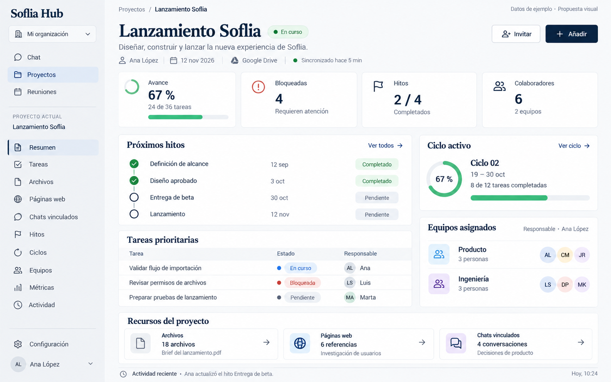
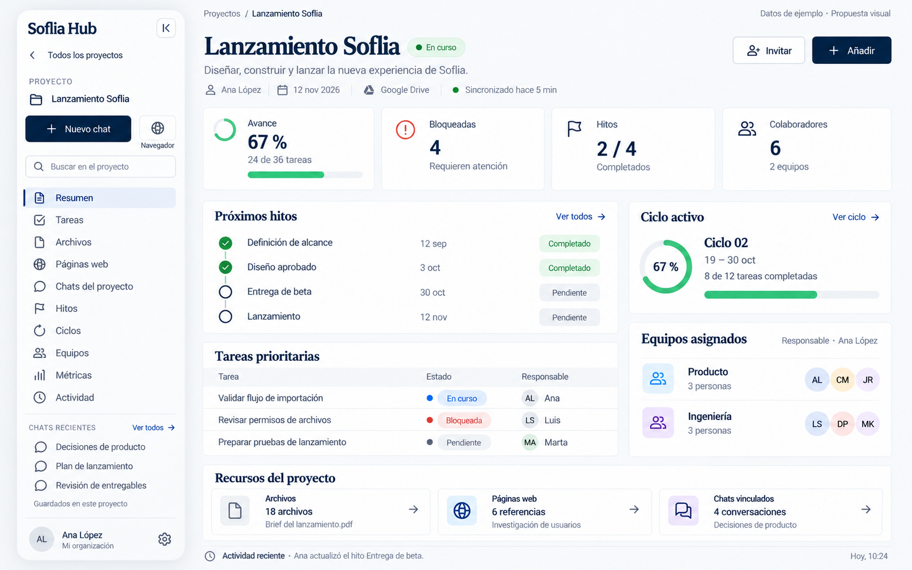

# Plan de proyectos portables y colaborativos en Soflia Hub

Estado: implementación parcial del panel; sistema portable completo pendiente. Fecha: 2026-10-23.

Actualización: el panel visual ya tiene implementación parcial conectada a los
contratos existentes; el sistema portable completo sigue en desarrollo. Se
mantiene la tipografía de interfaz del Hub también en títulos, la familia de
iconos existente y botones más redondeados. La fuente serif del mockup no se
traslada al producto. Alcance y verificación en
[el reporte del panel](reports/panel-implementation.md).

## Requerimiento mejor planteado

Como usuario de Soflia Hub quiero crear un proyecto en una carpeta que yo elija —local, dentro de una carpeta sincronizada de OneDrive/Google Drive o directamente en cualquiera de esos servicios—, mantener su identidad y registro en la base de datos, abrirlo desde otros equipos, importarlo/exportarlo y colaborar con otras personas sobre tareas y archivos. Al abrirlo quiero un apartado propio en la interfaz principal, distinto del chat y sin pestañas ni ventanas nuevas, que reúna información, recursos y seguimiento del trabajo sin perder datos ni compartir más de lo autorizado.

Confirmado contigo: se incluyen **ambas modalidades de nube** y **colaboración sobre proyecto, tareas y archivos**.

Ampliación confirmada: el apartado de proyecto incluye información general, archivos, páginas web y chats vinculados, hitos, equipos asignados, métricas y ciclos de trabajo cuando existan.

## 1. Qué significa un proyecto

El proyecto tendrá tres partes separadas:

| Parte | Qué conserva | Dónde vive |
|---|---|---|
| Registro compartido | Identidad, nombre, organización, tareas, miembros, revisiones y actividad | API/base de datos |
| Espacio de archivos | Documentos, entregables y metadatos portables | Carpeta o servicio elegido |
| Vínculo del equipo | Ruta local y cuenta con la que este usuario lo abre | Almacenamiento privado del dispositivo |

Ejemplo: Ana abre el proyecto Lanzamiento desde D:/Trabajo/Lanzamiento y Luis desde C:/Proyectos/Lanzamiento. Ambos ven el mismo proyecto y sus tareas; cada uno conserva su ruta. Para compartir archivos necesitan acceso a la misma raíz compartida o a copias publicadas expresamente.

Las carpetas actuales de conversaciones permanecen intactas. Pueden asociarse voluntariamente a un proyecto después, pero no se convierten ni se mueven por este cambio.

## 2. Crear y abrir proyectos

Flujo de creación:

1. Nombre, descripción, organización/equipo.
2. Ubicación: carpeta local, carpeta sincronizada, Drive directo o OneDrive directo.
3. Seleccionar carpeta padre/cuenta y revisar la subcarpeta que se creará.
4. Elegir si el proyecto es privado o qué archivos se compartirán, e invitar colaboradores.
5. Revisar destino, cuenta, permisos y efectos; confirmar.
6. Crear carpeta y manifiesto, registrar el proyecto y mostrar resultado verificable.

Si existe contenido, se ofrece abrir/adoptar con revisión o elegir otro nombre; no se sobrescribe. Cancelar la selección no crea un proyecto activo. Si falla la red después de crear carpeta, queda pendiente y se puede reanudar. Si falla la respuesta después de registrar, se comprueba el recibo antes de repetir.

En otro equipo se podrá abrir por proyecto compartido, seleccionar carpeta existente o importar un paquete. Si se movió una carpeta desde el explorador, «Volver a localizar» reparará el vínculo tras comprobar su identidad.

## 3. Dónde viven y se sincronizan los archivos

| Opción | Quién sincroniza archivos | Qué añade Soflia |
|---|---|---|
| Carpeta local | Nadie por defecto | Registro, tareas, metadatos y operaciones locales |
| OneDrive/Drive instalado | Aplicación de escritorio del proveedor | Vínculo del proyecto y estado comprobable |
| Drive directo | Conector de Soflia | Selector autenticado, permisos, transferencias y conflictos |
| OneDrive directo | Conector de Soflia | Lo mismo, con capacidades comprobadas de Graph |

En conexión directa la ubicación principal es la carpeta cloud; una copia local es opcional y se muestra como tal. No se ejecutarán dos sincronizadores de Soflia/proveedor configurados por el producto sobre el mismo árbol sin una transición controlada.

Para un proyecto sólo local, añadir colaboradores no permite entrar a ese PC. Habrá que escoger una raíz compartida o publicar copias aprobadas de los archivos elegidos en almacenamiento privado. El original permanece en la ubicación elegida. Compartir un proyecto no equivale a compartir todo el escritorio.

## 4. Metadatos para portabilidad

Se propone un archivo legible `.soflia/project.json` y un inventario que describa:

- Identidad portable estable, distinta de nombre/ruta.
- Versión de formato y compatibilidad mínima.
- Nombre, fecha y procedencia del proyecto.
- Referencia de servidor que habrá que volver a autorizar.
- Revisión de la instantánea de tareas y demás datos incluidos.
- Archivos: identificador, ruta relativa, tamaño, tipo, hash y revisión base.
- Qué contenido está incluido y qué elementos son sólo enlaces externos.

Tokens, contraseñas, .env, rutas absolutas, credenciales, preferencias privadas del dispositivo y permisos activos quedan fuera. Los roles escritos en un paquete no conceden acceso al importarlo.

## 5. Importar y exportar

Exportación propuesta: paquete `nombre.soflia-project.zip` con manifiesto, instantánea autorizada del proyecto/tareas y archivos elegidos. Antes de generarlo se revisan contenido, exclusiones, permisos, tamaño y referencias que no incluyen bytes.

Importación con tres opciones explícitas:

| Modo | Resultado |
|---|---|
| Abrir o vincular | Reconocer el mismo proyecto, comprobar permisos y guardar la ruta de este equipo |
| Crear una copia | Nuevo proyecto e IDs nuevos, relaciones remapeadas y procedencia conservada |
| Restaurar un proyecto | Comparar cambios, comprobar revisión/permiso y crear respaldo antes de aplicar |

No se restauran miembros automáticamente ni se reemplaza un proyecto sólo porque coincida su nombre. Paquetes dañados, incompatibles, con rutas externas o tamaños excesivos se rechazan antes de publicar cambios. Ningún archivo importado se ejecuta automáticamente.

## 6. Colaboración

Roles: propietario, administrador, miembro y lector/invitado, con permisos comprobados por servidor. La gestión de miembros, el traslado de raíz y la exportación/restauración masiva tienen capacidades separadas.

Invitar por usuario/correo tendrá aceptación, caducidad y revocación. Los externos sólo se habilitan si lo permite la organización, con acceso exclusivo al proyecto. Cada colaborador podrá elegir su ubicación local; Soflia verificará también sus permisos sobre los archivos del proveedor.

Un colaborador puede tener acceso a tareas y aún no a Drive: la UI mostrará ambas condiciones. Revocar bloquea acceso futuro y retira permisos creados por Soflia cuando sea posible; no elimina permisos externos preexistentes o copias ya descargadas. El acceso directo desde Drive/OneDrive depende de los permisos de ese servicio: Soflia no puede imponer ahí su membresía. Por eso las instantáneas de tareas se incluyen sólo en exportaciones expresamente revisadas, no en el manifiesto compartido cotidiano.

## 7. Orden de implementación

| Fase | Entrega | Condición para avanzar |
|---|---|---|
| 1. Base y contratos | Reconciliar retirada/seguridad; verificar API, permisos y recursos del panel | Una base única y contratos comprobados; sin sobrescribir trabajo ajeno |
| 2. Datos e identidad | Identidad portable, vínculos privados y registro idempotente | Dos usuarios no pueden acceder a proyectos ajenos; reintentos no duplican |
| 3. Ubicación física y navegación | Crear/abrir/trasladar; estructura del apartado de proyecto sin pestañas | Reinicio/fallo de red no pierde carpeta; abrir sustituye el chat por el resumen |
| 4. Portabilidad | Manifiesto, exportar, importar y restaurar | Round-trip con relaciones válidas, rechazo de paquetes maliciosos y sin ACL importadas |
| 5. Colaboración y panel | Invitaciones, recursos vinculados, hitos, equipos, ciclos y métricas autorizadas | Dos personas en dos equipos; privacidad de chats, métricas y permisos parciales comprobados |
| 6. Drive directo | Cuenta, selector, almacenamiento y permisos | Suite de proveedor con cambios externos, límites y cuentas soportadas |
| 7. OneDrive directo | Cuenta, selector, transferencias y permisos | Matriz personal/empresa y recuperación de conflictos comprobadas |
| 8. Sincronización | Cola offline, revisiones, conflictos y cambios externos | Dos editores no se pisan; ambas versiones se conservan |
| 9. Liberación | E2E, documentación, rollout y reversión | Gates, selectores nativos y pruebas reales entre actores/dispositivos |

El alcance final incluye las nueve fases. Un piloto local no se presentará como la integración completa de Drive/OneDrive.

## 8. Condiciones de éxito

- La carpeta elegida contiene realmente el proyecto, o se identifica claramente que la raíz primaria es cloud.
- Renombrar o cambiar de equipo no cambia la identidad del proyecto.
- Crear dos veces por un fallo de red no duplica proyectos/tareas.
- Un paquete puede trasladarse sin credenciales ni rutas privadas.
- Un colaborador recibe sólo los datos y archivos autorizados.
- Un conflicto conserva contenido y no aplica «última escritura gana» silenciosamente.
- Desvincular, archivar, mover y borrar son acciones distintas.
- Las carpetas, conversaciones y archivos anteriores no se migran ni borran automáticamente.
- Abrir un proyecto muestra su resumen en el área central y navegar sus apartados no crea pestañas ni ventanas.
- Los recursos privados no aparecen en títulos, previews, contadores o métricas de otros usuarios.
- Sin ciclos, equipos o datos suficientes se muestra ese estado, no información inventada.

## 9. Qué falta comprobar antes de codificar

La retirada previa está en el commit a7d705c de una rama separada y el checkout actual tiene otra línea de trabajo de seguridad. Primero se debe acordar la base y conservar los contratos/guardas útiles. La API existente no incluye todavía todos los contratos portables y su POST de proyecto solicita crear una carpeta Lia heredada: ese comportamiento debe adaptarse para evitar duplicados.

El reporte de permisos IRIS disponible es del 22 de octubre y requiere actualización/verificación antes de habilitar colaboración. Tener API no prueba que los permisos o endpoints nuevos estén listos. También se comprobarán scopes, pickers, carpetas compartidas y límites por proveedor/cuenta; no se solicitará acceso global por comodidad.

El conector Drive se diseñará con selección acotada y permisos mínimos, de acuerdo con [drive.file](https://developers.google.com/workspace/drive/api/guides/api-specific-auth) y el [Picker de escritorio](https://developers.google.com/workspace/drive/picker/guides/desktop-mobile-picker). Para OneDrive se comprobarán capacidades por cuenta: [AppFolder](https://learn.microsoft.com/en-us/graph/onedrive-sharepoint-appfolder) no equivale a elegir cualquier carpeta; las [sesiones de subida](https://learn.microsoft.com/en-us/graph/api/driveitem-createuploadsession?view=graph-rest-1.0) permiten controles de versión que se probarán antes de prometer sincronización segura.

La ejecución se detalla en [tasks.md](tasks.md); decisiones y contratos propuestos en [design.md](design.md); criterios normativos en las cuatro especificaciones de [la propuesta](proposal.md).

## 10. Apartado de proyecto: experiencia y diseño

La barra lateral global incorpora Proyectos. Seleccionar uno abre su Resumen en el área central de Soflia, manteniendo la interfaz de la aplicación. El proyecto tiene navegación vertical contextual, sin barra de pestañas, ventanas emergentes ni un chat como pantalla de entrada.

El encabezado identifica proyecto, estado, responsable, fechas y ubicación. Debajo, un resumen ofrece avance, bloqueos, próximos hitos, ciclo activo, equipos y recursos recientes. Las tarjetas son accesos a detalles, no contenedores de toda la información del proyecto.

| Sección del menú vertical | Qué podrá consultar el usuario |
|---|---|
| Resumen | Objetivo, descripción, estado, responsables, fechas y actividad reciente |
| Tareas | Lista filtrable, asignación, prioridad, fechas y relación con hitos/ciclos |
| Archivos | Carpetas, documentos y entregables con origen, permisos y estado de sincronización |
| Páginas web | Referencias e investigaciones guardadas con URL, título y procedencia |
| Chats del proyecto | Conversaciones nuevas creadas aquí y chats vinculados explícitamente; abrir y volver conservando contexto |
| Hitos | Entregables importantes, fechas, responsables y tareas asociadas |
| Ciclos | Periodos de trabajo opcionales y tareas comprometidas; Sin ciclos si no se utilizan |
| Equipos | Equipos asignados, responsables y colaboradores, distinguiendo asignación de permisos |
| Métricas | Avance, bloqueos, vencimientos, hitos y rendimiento por ciclo si hay historial |
| Actividad | Cambios relevantes y decisiones con actor y fecha |

Seleccionar una sección o recurso cambia la misma superficie central. Un chat vinculado abre su conversación con breadcrumb de regreso al proyecto; una página o archivo muestra detalle/vista previa segura en esa superficie. Si no puede previsualizarse, se explica sin abrir pestañas o ventanas como solución automática. Volver conserva filtros y posición; cambiar al chat global preserva su borrador.

Vincular un chat no comparte una conversación privada ni mueve su carpeta. Publicar su contenido al proyecto requiere revisar audiencia y permisos, además de soporte real del dominio de chats. Un recurso no autorizado tampoco aparece en contadores agregados o títulos. Desvincular conserva el original.

Las métricas se calculan con reglas visibles: avance sobre tareas no canceladas, bloqueos sólo si se registran como tales, vencimientos según fecha y zona del proyecto. Sin tareas se muestra Sin tareas. Gráficos de velocidad, tiempo de ciclo o burndown requieren historial suficiente; no se deducen de una cifra actual. Se distingue Sin datos de Error, Sin acceso o Última actualización offline.

Para no aumentar deuda técnica se reutilizan tokens y navegación de Soflia, se separan componentes por dominio, se cargan detalles bajo demanda y se comparte la definición de métricas entre resumen y detalle. La existencia de un endpoint de analítica o un equipo principal no acredita soporte completo: hitos, ciclos, múltiples equipos e historial deben verificarse y extenderse donde falten.

La propuesta visual usa tema claro, navy, tarjetas blancas y menú vertical. Se generó una imagen conceptual con un proyecto ficticio Lanzamiento Soflia, rotulada Datos de ejemplo. Las cifras son sólo material de diseño. El modo oscuro debe usar los tokens actuales; no se crea una paleta paralela.

Primera propuesta: contenido central aprobado. El lateral de esta imagen queda sustituido por la revisión del apartado 11.



Imagen guardada en reports/project-panel-v1.png mediante la herramienta integrada de generación de imágenes. Se revisaron composición, texto, navegación sin pestañas y coherencia de las cifras de ejemplo. Es una referencia visual de la pantalla inicial; estados de error, detalles, accesibilidad y comportamiento adaptable se validarán al implementar.

Implementación: estructura de navegación en fase 3; datos, recursos y permisos del panel en fase 5; aceptación completa en fase 9. Las tareas del bloque 10 son transversales a esas fases, no un añadido posterior a la liberación.

## 11. Revisión del lateral: patrón flotante de Soflia y chats del proyecto

Se conserva el contenido central aprobado. El lateral adopta el patrón real de Sidebar: separado aproximadamente 10 px del borde, esquinas rounded-2xl, blanco translúcido, borde fino, blur y sombra suave. En oscuro hereda los tokens existentes. Flotante es un tratamiento visual dentro del layout; reserva espacio para no tapar el panel. Se reutilizan cabecera, acciones, perfil, colapso y ajuste de ancho del Hub.

| Zona del lateral | Contenido |
|---|---|
| Cabecera | Soflia Hub, colapsar menú, Todos los proyectos e identidad del proyecto actual |
| Acciones | Nuevo chat y globo Abrir navegador del proyecto; búsqueda limitada al proyecto |
| Navegación | Resumen, Tareas, Archivos, Páginas web, Chats del proyecto, Hitos, Ciclos, Equipos, Métricas y Actividad |
| Conversaciones | Recientes/fijadas del proyecto y Ver todos; grupo desplazable o contraíble para no ocultar la navegación |
| Pie | Perfil, organización y configuración autorizada |

Todos los chats creados desde este apartado permanecen en el proyecto, incluidos los iniciados desde tareas, atajos o el navegador. La asociación se guarda con la conversación y se recupera tras reiniciar o reconectar; un error no la manda al chat general. Al cambiar de proyecto durante una operación, el chat conserva su proyecto de origen. Pertenecer al proyecto y compartir con colaboradores son decisiones distintas: se muestra la visibilidad efectiva y se respetan permisos. Los chats generales previos no se trasladan automáticamente.

El globo abre el navegador integrado en la misma interfaz, conservando el proyecto y el regreso al panel. Su selector de conversaciones y Nuevo chat siguen dentro del proyecto. Entrar al navegador no genera una pestaña o ventana nueva; navegar no guarda automáticamente todas las páginas visitadas. Guardar una página es explícito. Se reutiliza el motor web existente y se reserva su viewport real para que no tape el lateral flotante.

Fuentes revisadas: [sistema visual](../../../docs/ux/design-system.md), [estándar de interfaz](../../../docs/standards/design-system.md), [arquitectura frontend](../../../docs/architecture/frontend.md), [Sidebar](../../../src/components/Sidebar.tsx), [acciones](../../../src/components/sidebar/SidebarTopActions.tsx), [herramientas](../../../src/components/sidebar/SidebarNavTools.tsx), [layout del navegador](../../../src/components/browser/BrowserWorkspaceLayout.tsx), [visor](../../../src/components/artifacts/ArtifactViewerPanel.tsx), [productividad](../../../src/components/ProductivityDashboard.tsx) y [reuniones](../../../src/components/meetings/MeetingOpsPanel.tsx). Son referencias locales observadas, sin cambios de código en esta entrega.

Criterios añadidos: persistencia del chat y pertenencia tras recargar, separación entre proyectos, búsqueda/conteos sin datos ajenos, creación offline recuperable, navegador sin ocultar el menú y resize/colapso usable con teclado, zoom y baja altura. La especificación técnica y las tareas 10.13–10.17 detallan la implementación pendiente.

### Prompt de edición del lateral flotante

Propuesta visual vigente: lateral flotante con Nuevo chat, globo Navegador, búsqueda y conversaciones del proyecto. Se conserva la organización y contenido del panel central aprobado, con ajuste de espacio para el lateral.



Archivo: reports/project-panel-v2.png. Imagen editada con la herramienta integrada de generación de imágenes, preservando la primera versión. Revisión visual: cuatro esquinas separadas del borde, menú completo, acceso de navegador identificable, chats recientes dentro del proyecto y contenido central conservado. El mockup no prueba persistencia ni funcionamiento de la integración.

Método: herramienta integrada de generación de imágenes, editando la imagen inicial como referencia y conservándola. Prompt utilizado:

```text
Caso de uso: ui-mockup, edición precisa de interfaz.
Imagen 1 es el objetivo de edición: propuesta aprobada del panel de Soflia Hub. Cambiar ÚNICAMENTE el menú lateral izquierdo. Conservar el panel central aprobado: mismo título Lanzamiento Soflia, encabezado, acciones, tarjetas de indicadores, hitos, tareas, ciclo, equipos, recursos, tipografías y datos de ejemplo. No rediseñar las tarjetas ni modificar sus cifras. Mantener la composición y tamaño general de la imagen de entrada.

Objetivo: sustituir la barra rectangular pegada al borde por el lateral flotante real de la aplicación Soflia. Una sola superficie lateral, separada 10 px del borde izquierdo, superior e inferior del lienzo. Cuatro esquinas claramente redondeadas, radio 16–20 px, borde fino gris tenue, blanco al 80 % sobre canvas claro #f9fafb, blur sutil y sombra navy muy suave equivalente a 0 12px 40px rgba(10,37,64,0.08). La isla flotante mide aproximadamente 260 px de ancho y conserva su posición a la izquierda del contenido; dejar visible el margen exterior y todas las esquinas. No es una ventana, no es una segunda barra. No usar marco OS, browser chrome, pestañas, modales ni un compositor de chat. No tapar ni recortar el contenido central.

Replicar los patrones de componentes existentes: cabecera de marca compacta sans serif Inter Tight con texto 'Soflia Hub' de 14–16 px y botón icono de colapso en su extremo derecho; acciones rounded-xl, iconos de línea 18 px con trazo 1.8; etiquetas IBM Plex Sans; navy #0a2540 y secundarios #6c757d, bordes #e9ecef. Selección con una píldora navy muy pálida y pequeño marcador navy, foco visual sutil. Nada de sombras pesadas, degradados, decoración, logos o colores de marca nuevos.

Diseño del lateral de arriba abajo, compacto pero legible:
1. Marca 'Soflia Hub' y pequeño icono colapsar.
2. Enlace con flecha izquierda 'Todos los proyectos'.
3. Bloque de identidad 'Lanzamiento Soflia' con pequeño icono de proyecto y una etiqueta discreta 'PROYECTO'. No colocar navegación global Chat/Proyectos/Reuniones en este contexto.
4. Fila de acciones: botón ancho '+ Nuevo chat' y, a su derecha, botón cuadrado redondeado con icono globo de navegador de meridianos y paralelos. Bajo el globo o junto a él, etiqueta pequeña pero legible 'Navegador' que deje obvia la función sin tooltip abierto. El globo abre el navegador dentro del proyecto. No abrir navegador en esta imagen: el resumen sigue activo.
5. Campo de búsqueda compacto con lupa y texto 'Buscar en el proyecto'.
6. Menú vertical compacto de filas de unos 29 px, icono y texto: 'Resumen' activo; 'Tareas'; 'Archivos'; 'Páginas web'; 'Chats del proyecto'; 'Hitos'; 'Ciclos'; 'Equipos'; 'Métricas'; 'Actividad'. No omitir apartados y no convertirlos en pestañas.
7. Divisor tenue; grupo 'CHATS RECIENTES' con enlace 'Ver todos'. Tres conversaciones de ejemplo con pequeño icono de conversación, cada una en una fila: 'Decisiones de producto', 'Plan de lanzamiento', 'Revisión de entregables'. No repetir como una segunda barra. Texto discreto de apoyo 'Guardados en este proyecto' si queda espacio.
8. Pie separado por línea: avatar con iniciales AL, 'Ana López', subtítulo 'Mi organización', y pequeño botón engranaje de configuración. El pie permanece dentro de la isla y por encima de la esquina redondeada inferior.

Distribuir todo para que quepa con márgenes adecuados y sin letra diminuta. Los chats son parte del proyecto, no una lista global; no mostrar otros proyectos o chats personales. La isla debe verse flotante y redondeada en sus cuatro esquinas. Mantener todos los textos en español. Preservar la indicación superior derecha 'Datos de ejemplo · Propuesta visual'. La imagen final es una única propuesta refinada del mismo dashboard aprobado, no un collage, no varias alternativas.
```

### Prompt de la primera propuesta visual (referencia histórica)

Método: herramienta integrada de generación de imágenes, imagen nueva sin referencias. Prompt utilizado:

```text
Caso de uso: ui-mockup. Crear una única imagen de alta fidelidad del nuevo panel de proyecto de la aplicación de escritorio Soflia Hub. Es una propuesta conceptual de producto, no una fotografía. Lienzo horizontal amplio aproximadamente 1800 por 1125, interfaz plana de frente, sin perspectiva ni marco de dispositivo; la aplicación llena la imagen. Todo el texto visible en español, cuidadosamente legible. No mostrar ventanas adicionales, pestañas horizontales, barra de navegador, chat/compositor, modales ni popups. Mostrar un solo apartado de proyecto dentro de la misma interfaz.

Estética basada en los tokens reales de Soflia: fondo #f9fafb, barra lateral #f0f2f5, superficies blancas, bordes muy discretos #e9ecef, títulos y botones navy #0a2540, secundarios #6c757d. Verde de estado sólo como señal semántica. Título de proyecto con serif editorial elegante tipo Newsreader, texto y números Inter Tight, etiquetas IBM Plex Sans. Estilo sobrio, profesional y espacioso, con jerarquía clara, iconos de línea fina y tarjetas de radio moderado; evitar sombras fuertes, degradados, neón y adornos.

Composición: una barra lateral izquierda de 230 píxeles ocupa toda la altura. Arriba wordmark sencillo 'Soflia Hub', selector 'Mi organización'. Navegación global 'Chat', 'Proyectos' activo, 'Reuniones'. Debajo divisor y etiqueta 'PROYECTO ACTUAL', nombre pequeño 'Lanzamiento Soflia'. Menú vertical contextual: 'Resumen' seleccionado en fondo navy muy pálido y acento lateral; 'Tareas', 'Archivos', 'Páginas web', 'Chats vinculados', 'Hitos', 'Ciclos', 'Equipos', 'Métricas', 'Actividad'. Pie lateral con 'Configuración' y usuario ficticio 'Ana López'. No crear una segunda barra lateral. No hacer pestañas con estos ítems.

Área principal amplia a la derecha, padding 32–40 píxeles. Franja superior discreta: breadcrumb 'Proyectos / Lanzamiento Soflia'; a la derecha etiqueta legible 'Datos de ejemplo · Propuesta visual'. Encabezado grande 'Lanzamiento Soflia', badge 'En curso'. Descripción breve 'Diseñar, construir y lanzar la nueva experiencia de Soflia.' Acciones de la esquina 'Invitar' y botón navy '+ Añadir'. Metadatos en línea con iconos pequeños: 'Ana López', '12 nov 2026', 'Google Drive'. Texto de estado de sincronización discreto. Sin barra horizontal de navegación.

Fila de cuatro tarjetas de indicadores con cifras grandes: 'Avance' con '67 %' y '24 de 36 tareas'; 'Bloqueadas' con '4' y 'Requieren atención'; 'Hitos' con '2 / 4' y 'Completados'; 'Colaboradores' con '6' y '2 equipos'. Barras/progreso sólo donde la cifra los justifica. No añadir gráficas históricas o números aleatorios.

Debajo una cuadrícula organizada con columna izquierda dos tercios y derecha un tercio. Tarjeta izquierda 'Próximos hitos' con acción textual 'Ver todos', cronología vertical compacta y cuatro filas: 'Definición de alcance' completado; 'Diseño aprobado' completado; 'Entrega de beta' fecha '30 oct'; 'Lanzamiento' fecha '12 nov'. Dos primeros con check verde, siguientes círculos contorno navy. Bajo esa tarjeta, tabla compacta 'Tareas prioritarias' con tres filas: 'Validar flujo de importación' / 'En curso' / 'Ana'; 'Revisar permisos de archivos' / 'Bloqueada' / 'Luis'; 'Preparar pruebas de lanzamiento' / 'Pendiente' / 'Marta'. Encabezados 'Tarea', 'Estado', 'Responsable'. Etiquetas de estado discretas, filas limpias.

Columna derecha: tarjeta 'Ciclo activo', nombre 'Ciclo 02', fechas '19–30 oct', '8 de 12 tareas completadas' y barra al 67%, acción textual 'Ver ciclo'. Debajo tarjeta 'Equipos asignados' con filas 'Producto' y 'Ingeniería', cada una '3 personas' y pequeños avatares con iniciales, sin fotografías reales. Pequeña nota 'Responsable · Ana López'.

Parte inferior a lo ancho del contenido: encabezado 'Recursos del proyecto' y tres tarjetas rectangulares cortas para 'Archivos' / '18 archivos' / 'Brief del lanzamiento.pdf'; 'Páginas web' / '6 referencias' / 'Investigación de usuarios'; 'Chats vinculados' / '4 conversaciones' / 'Decisiones de producto'. Iconos diferentes, flecha sutil de entrada a detalle. Si cabe, una fila de actividad al pie 'Actividad reciente · Ana actualizó el hito Entrega de beta'. Mantener márgenes y legibilidad; no recortar textos.

Debe sentirse como un panel usable dentro de Soflia, con contenido bien alineado y una sola superficie principal. Los botones y datos son ficticios de la propuesta visual; no añadir código, nombres de herramientas técnicas, tokens OAuth ni rutas de archivos locales. Renderizar una sola imagen final de interfaz pulida, no un collage ni múltiples variantes.
```
