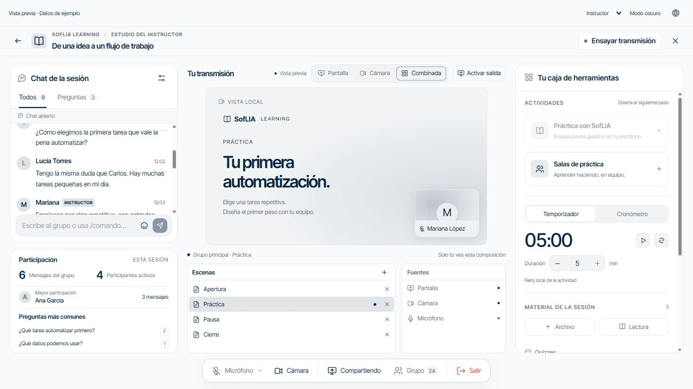

# Escenas compactas

Fecha: 2026-10-24. Desarrollo aislado en `codex/compact-studio-scenes` desde 427b9fb.

## Resultado
Un solo monitor, lista de escenas en filas de 28 px y dock de fuentes a su lado.
Se retiraron el panel de transiciones, efectos, duración, contenido intermedio,
segundo monitor y aviso de pantalla preparada. La salida se activa explícitamente;
cambiar de fila después aplica corte directo sin recrear la pista.
El programa anterior se conserva si falla la fuente. Se mantienen creación,
retirada, vínculo de pantalla, pantallas del curso y su reloj.

Se eliminaron el componente/CSS de transiciones y la opción visualOnly del editor
sin consumidores restantes. Los algoritmos internos del compositor no cambian:
esta solicitud modifica el flujo del instructor, no el contrato nativo.

## Verificación
- Tres archivos de componentes afectados: 21 pruebas correctas en la última repetición.
- Suite completa: 499 archivos correctos, 2 omitidos; 5692 pruebas correctas, 5 omitidas. Duración 119,63 s.
- Lint incremental: siete archivos sin deuda nueva.
- OpenSpec estricto correcto y enlaces de 713 Markdown válidos.
- `git diff --check` correcto; revisión independiente studio_review sin P1/P2.
- UI probada a 1280×720, 1920×1080 y 500×800. Cuatro escenas visibles y cambio por clic comprobado.
  A 1280×720, escenario clientHeight/scrollHeight 537/537 y lista 134/134.
  A 1920×1080, escenario 897/897. A 500×800, escenario 579/579, sin overflow horizontal.

## Excepción de compuerta
`npm run verify:pr` pasó arnés, documentación, supply chain y OpenSpec, pero se
detuvo en typecheck por `electron/gmail/raw-message.ts:19`: la propiedad newline
no existe en Options de los tipos instalados. El archivo coincide con HEAD y no
pertenece al cambio. La comprobación TypeScript aislada también informa ese error;
no se afirma compuerta aprobada. Se ejecutaron lint y suite completa por separado.

Sin cambios en Learning, IPC, permisos de captura, secretos, producción ni trabajo
ajeno de creación de proyectos. La fixture de revisión usa datos de ejemplo y no
acredita una reunión real.

Rollback: revertir el commit del cambio; no hay migración ni datos por restaurar.
