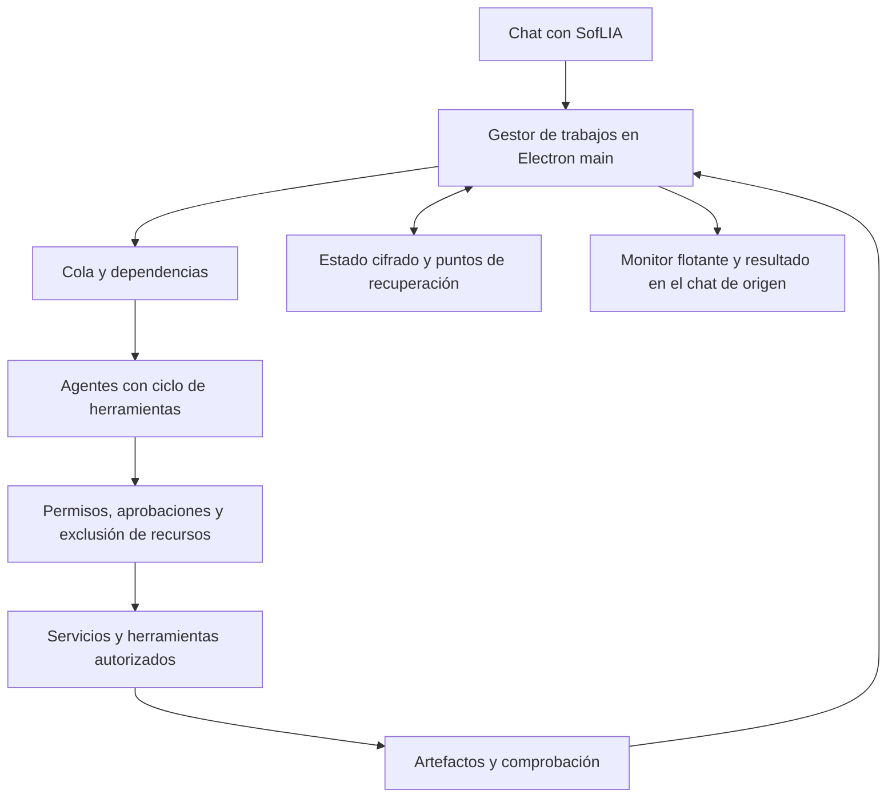

# Diseño propuesto de equipos ejecutores

Estado: fase local implementada; decisiones de fases 2 y 3 pendientes. Fecha: 2026-10-11.
Contexto y evidencia: [contexto](context.md), [investigación](reports/research.md).

## Capacidad implementada

La fase local ya dispone de dos ejecutores y un coordinador en Electron main,
cola y persistencia cifrada, presupuestos, cancelación/pausa/reanudación y
verificación de archivos. Las herramientas disponibles leen contexto y aportes,
crean Markdown/texto/CSV/Word, Excel y PowerPoint, y realizan investigación pública
cuando el encargo la autoriza. El coordinador lee los archivos reales; el chat
muestra operaciones, resultado y todos los entregables comprobados.

Los envíos, integraciones con efectos externos, control de pantalla compartida,
programación y ejecución remota siguen reservados a las fases siguientes. Las
secciones de ampliación de esta propuesta describen ese diseño futuro, sin
atribuirlo al runtime actual. La evidencia vigente está en [verificación](reports/verification.md).

## DEC-BTE-001: SofLIA conserva la conversación y delega ejecución

El coordinador interpreta el encargo y define un resultado observable, un grafo de subtareas y el presupuesto. Cada agente recibe objetivo, entradas autorizadas, capacidades, destino y comprobaciones. Los agentes pueden consultar herramientas y crear resultados durante varios pasos; devuelven evidencia, artefactos y errores al coordinador.

El modo automático selecciona respuesta directa, preparación breve o trabajo ejecutable según el resultado solicitado, las capacidades disponibles y el beneficio de separar subtareas. Pedir «usa multiagentes» permite formar un equipo, pero no concede nuevas fuentes, permisos ni efectos externos. Un archivo o página que contenga esa frase tampoco inicia un trabajo.

La topología inicial es un coordinador y ejecutores, con mensajes estructurados a través del gestor. No hay delegación recursiva. Una comunicación directa entre compañeros se evaluaría después, si mejora casos medidos; sus mensajes siguen siendo datos y nunca pueden ampliar permisos.

## DEC-BTE-002: el trabajo pertenece a main

El renderer solicita iniciar y recibe un identificador después de validar y guardar el trabajo. No espera a que los agentes terminen. Main mantiene cola, cancelación, proveedores, estado y eventos. El renderer puede desmontarse, cambiar de conversación u ocultar el monitor sin cancelar el trabajo.

Las llamadas al modelo son asíncronas. La conversión documental o el cálculo intensivo se ejecutan mediante servicios existentes fuera del hilo principal cuando corresponda. La separación de procesos de Electron no es por sí misma una barrera suficiente para ejecutar código arbitrario.

El cierre del panel solo oculta la vista. Detener la respuesta del chat y cancelar un trabajo son controles diferentes: la UI identifica explícitamente qué se está deteniendo. Una tarea devuelve su resultado al chat de origen; no lo añade al chat que casualmente esté abierto cuando termina.

El acceso se mantiene mientras siga vigente la identidad y organización del trabajo. Cambiar de usuario u organización revoca la ejecución local activa y limpia la vista anterior. Reanudar exige volver a validar el alcance y los recursos, sin recuperar automáticamente permisos caducados.

## DEC-BTE-003: capacidades propias, permisos heredados y acotados

El conjunto efectivo de herramientas es la intersección de las permitidas por producto y superficie, la selección del usuario/skill runtime, el perfil del agente, el encargo y sus recursos. Catálogo y dispatcher aplican el mismo conjunto. Las credenciales permanecen en los servicios autorizados; no se incluyen en prompts, mensajes entre agentes ni eventos del renderer.

| Perfil propuesto | Capacidades operativas | Restricción principal |
| --- | --- | --- |
| Investigador | Búsqueda y lectura de fuentes disponibles, extracción de evidencia | Solo fuentes autorizadas; no enviar ni modificar contenido remoto |
| Creador de documentos | Crear y editar en su workspace, generar formatos soportados | Destino explícito; no abrir ventanas al guardar en fondo |
| Operador de archivos | Leer y preparar organización o copias solicitadas | Rutas canónicas autorizadas; borrado y operaciones críticas con HITL |
| Operador de integración | Leer servicios conectados, preparar borradores y ejecutar acciones aprobadas | Cuenta y recurso concretos; revisión del efecto final |
| Verificador | Abrir artefactos y comprobar contenido, cálculos, fuentes y requisitos | Comprobación independiente del mensaje del productor |

Reutilizar `workspace_read_file`, `workspace_write_file`, `workspace_edit_file`, `read_file` y `create_word_document` como candidatos mediante adaptadores del servicio real. Las declaraciones actuales no bastan: hay que comprobar sus validaciones y su ruta desde main. No usar por defecto el Escritorio ni abrir el documento al terminar; los agentes de fondo reciben un destino propio y explícito.

Los adaptadores eliminan dependencias del «chat activo» o del workspace global. Fuentes, archivos auxiliares, contexto de skill y resultados de herramientas pertenecen al job ID y a su propietario; cambiar de conversación no puede cambiar las entradas ni adjuntar archivos de otra tarea.

No ofrecer formatos o herramientas que todavía no tengan ejecutor. Excel/PDF/presentaciones requieren un inventario de exportadores y verificadores; donde falten, se añade una capacidad tipada o se comunica el formato disponible. No se entrega shell general, Git ni skills de desarrollo a los agentes runtime.

Antes de cada llamada, el host valida identidad SOFIA, propietario operativo Lia cuando corresponda, organización, generación de sesión, recurso, límites, aprobación y exclusión de escritura. Las restricciones de documentos adjuntos se mantienen: delegar no autoriza buscar otras fuentes cuando el encargo está limitado a un extracto.

## DEC-BTE-004: coordinación mediante dependencias y recursos exclusivos

Cada subtarea tiene entradas, dependencias, estado, propietario y criterio de terminación. La cola libera únicamente subtareas cuyas entradas estén disponibles y aceptadas. Si un productor falla, sus consumidores esperan o se replanifican con el alcance original; no inventan los datos faltantes.

Un archivo, documento remoto o sesión de pantalla compartida tiene un único escritor/controlador activo, con una reserva temporal y un identificador de generación que invalida acciones tardías. La exclusión de pantalla se aplica al dispositivo, incluso entre equipos distintos. Otros agentes pueden investigar por API o trabajar en archivos independientes mientras esperan el recurso.

Los agentes escriben en carpetas propias. La unión del entregable usa versiones y comprobación de cambios del usuario; no sobrescribe silenciosamente una edición posterior. Las pestañas o contextos independientes pueden paralelizarse únicamente cuando el servicio soporte ese aislamiento. Una pantalla compartida no admite varios controladores concurrentes.

## DEC-BTE-005: persistencia y recuperación conservadoras

El repositorio guarda cifrados trabajo, subtareas, entradas necesarias, permisos delimitados, referencias a artefactos, consumo y resultados observados. Se aprovecha el patrón de guardado atómico del arnés de reuniones, sin confundir su reejecución actual con recuperación por punto de control.

Se guarda un punto de recuperación tras cada paso confirmado y antes de un efecto externo. Al reiniciar, un paso sin resultado confirmado queda interrumpido o incierto. Los pasos completados y sus archivos válidos se reutilizan; las lecturas pueden repetirse si siguen autorizadas.

Una operación externa registra intención, destino, resumen/digest del payload, clave de idempotencia si el proveedor la admite y recibo. Si se pierde la respuesta después de un posible envío, se consulta el estado remoto o se solicita conciliación; no se envía otra vez por defecto. No se promete ejecución exactamente una vez cuando el proveedor no ofrece garantías suficientes.

El almacenamiento no conserva secretos ni razonamiento privado del modelo. Los eventos contienen metadatos y referencias seguras. Inputs, artefactos y logs tienen límites de tamaño, política de retención y limpieza de temporales bajo su propietario. Si no existe cifrado disponible, el trabajo duradero se rechaza o se ofrece una ejecución volátil identificada explícitamente, sin fallback a texto plano.

## DEC-BTE-006: estados y finalización verificables

Estados candidatos: `queued`, `running`, `waiting_input`, `waiting_approval`, `waiting_resource`, `pausing`, `paused`, `verifying`, `completed`, `failed`, `cancelled`, `interrupted`, `uncertain`. La UI usa etiquetas en español y explica la causa de espera.

Terminar una llamada del modelo no termina el trabajo. Para `completed`, las comprobaciones de aceptación deben aprobar: archivos existentes y legibles, contenido esperado, referencias, cálculos y recibos cuando haya efectos. Si hay resultados útiles pero incompletos, se conservan y se identifican las comprobaciones pendientes.

Cancelar propaga la señal a modelos, herramientas y subtareas, invalida futuras acciones y libera recursos. La respuesta tardía de un proveedor no reactiva el trabajo. Pausar espera a un punto seguro: una operación ya enviada podría concluir y debe reconciliarse. La aplicación informa los efectos confirmados o inciertos; cancelar no equivale a revertir lo ya ejecutado.

## DEC-BTE-007: monitor con acciones y entregables

Conservar la ventana flotante y los tokens visuales vigentes. Cada tarjeta muestra agente, subtarea, estado, última operación confirmada y duración. Los archivos comprobados se pueden abrir; las aprobaciones indican solicitante, destino y efecto exacto.

Los controles operan sobre trabajos del host: pausar, continuar, cancelar y reintentar de forma segura. Un reintento no equivale a continuar; la vista explica cuál se permite. Mostrar etapas completadas y operaciones, sin porcentajes inventados ni frases que atribuyan ejecución antes de tener evidencia.

Notificar finalización, fallo o intervención necesaria. Evitar avisos repetidos sin cambios. Mantener historial accesible aunque el trabajo salga de la lista de actividad reciente, cuyo almacenamiento actual es limitado y no sustituye al repositorio de tareas.

## Contratos futuros y fronteras

Estos contratos son propuestas; los identificadores definitivos se fijarán en la especificación de implementación y deberán revisarse contra las allowlists existentes.

| Contrato | Contenido y obligación |
| --- | --- |
| Trabajo | ID, objetivo, chat/proyecto de origen, alcance inmutable obtenido por el host, entorno de ejecución, presupuesto y criterios |
| Subtarea/agente | ID, perfil, dependencias, capacidad permitida, versión de entradas, estado y consumo |
| Artefacto | ID, productor, propietario, ruta o referencia validada, formato, versión/hash y comprobaciones |
| Aprobación | Actor, efecto, recurso, digest, caducidad y recibo; un cambio invalida la aprobación |
| Evento | Job ID, agent ID, secuencia, generación, estado y metadatos seguros; snapshot y reconexión por secuencia |
| Error | Código y mensaje controlados; estado recuperable o incierto; sin credenciales ni stack interno |

Operaciones candidatas: iniciar, consultar/listar, suscribirse, pausar, reanudar, cancelar y resolver aprobación. Todas pasan por servicio main → handler validado → preload allowlist → wrapper tipado del renderer. No se aceptan identidades ni capacidades elegidas libremente por el payload del renderer. La auditoría propaga un identificador de correlación por trabajo, subtarea y llamada.

## LIM-BTE-001: presupuesto inicial para experimentar

Valores propuestos, pendientes de evaluación; no son límites actuales ni promesas de rendimiento:

- Primer incremento: dos ejecutores activos; ampliar hasta cuatro por equipo solo tras pruebas de carga, calidad y coste.
- Un coordinador administra un presupuesto total por trabajo y reservas por subtarea, incluyendo verificación y reintentos; las cuotas de cuenta también incluyen llamadas de agentes.
- Ventana inicial configurable de diez minutos para un trabajo local y hasta doce iteraciones de modelo por subtarea. Las herramientas mantienen sus propios límites; una operación de larga duración no hereda un timeout de 15 segundos.
- Máximo una generación de delegación; nada de creación ilimitada de agentes. Cola global acotada y prioridad para interacción del usuario.

Los modelos y el nivel de razonamiento se seleccionan según proveedor configurado, capacidad, tarea y evaluación. No imponer esfuerzo bajo a todo ejecutor ni duplicar el modelo más costoso en todos los roles. Mantener adaptadores de los proveedores actuales; adoptar un SDK sería una decisión separada, no una condición para esta arquitectura.

## LIM-BTE-002: qué significa segundo plano

| Modalidad propuesta | Puede continuar | Condición |
| --- | --- | --- |
| Local, fase 1 | Cambiar de chat, ocultar panel o dejar de interactuar | Proceso main vivo, sesión vigente y recursos disponibles |
| Recuperación local, fase 1 | Retomar pasos seguros después de reiniciar | Cifrado disponible, puntos guardados y autorización revalidada |
| Remota, fase 3 | Trabajar con Soflia Hub cerrado o el ordenador apagado | Infraestructura remota; herramientas y datos accesibles allí con permiso |
| Remota con recurso local, fase 3 | Coordinar en nube y solicitar pasos locales | Puente autenticado y ordenador conectado; si falta, esperar el recurso |

No subir carpetas ni migrar contextos de ejecución automáticamente. La futura infraestructura remota define identidad de servicio, aislamiento, retención, costes y permisos. Programar o reaccionar a eventos exige una solicitud expresa; iniciar un trabajo no crea seguimiento indefinido.

## Validación, transición y reversibilidad

La [especificación](specs/executable-background-teams/spec.md) contiene los escenarios. Antes de activar el flujo, comparar casos de investigación, archivos, documentos e integración con un ejecutor único: tasa de cumplimiento, calidad revisada, latencia, consumo, conflictos e intervención requerida. Conservar equipo solo donde aporte valor demostrado.

Implementar mediante capacidad/flag por superficie, inicialmente chat. Mantener los contratos del análisis breve, reuniones, WhatsApp y computer use; no ampliar permisos de grupos. Al desactivar el nuevo flujo, detener admisión de trabajos, conservar los artefactos y ofrecer recuperación o cancelación de los existentes. No ocultar tareas activas ni borrarlas como rollback.
