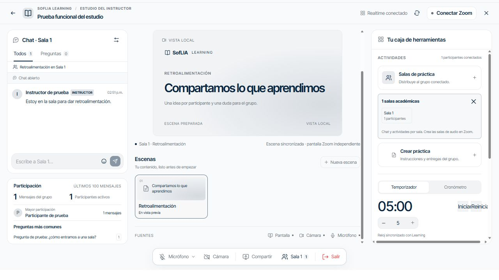
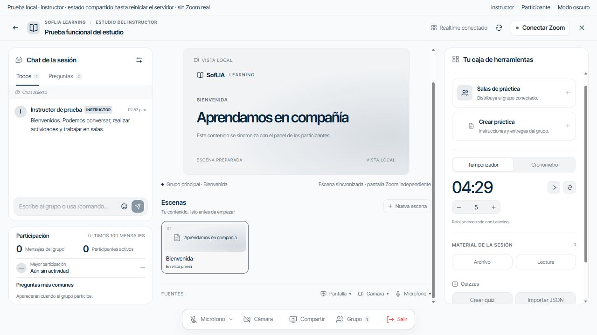

# Evidencia de implementación local

Fecha: 2026-10-12. Ramas Hub y Learning: `codex/live-studio-runtime`.

## Alcance comprobado

- Contrato y dominio canónicos en Learning; Hub sincroniza copias mediante `node scripts/quality/sync-learning-studio.mjs --check`.
- Backend con actor del servidor, CAS transaccional, deduplicación, presencia concurrente, proyección por rol/sala, archivos privados y limpieza con reclamación exclusiva.
- Electron conserva bearer en main, observa revisiones privadas y permite recuperación mediante snapshot autorizado.
- Dos vistas locales: pregunta de alumno recibida por instructor; creación/publicación/respuesta de quiz; creación de sala, entrada de alumno, visita del instructor y mensaje con insignia; escena nueva visible en ambos paneles.
- Carga nativa del Meeting SDK compilado con CSP real, iframe sandbox y origen `soflia-zoom://meeting`. No ingresó a una reunión ni capturó medios durante el smoke.

## Verificación

- Hub: `npm run verify:pr` correcto en el código final: typecheck, lint incremental, arnés, documentación, supply chain, OpenSpec y suite completa. 417 archivos correctos, 1 omitido; 4284 pruebas correctas, 1 omitida. Duración de tests: 64,24 segundos.
- Learning: `npm run test -- src/features/live/__tests__ src/proxy/__tests__/live-access-rate-limit.test.ts`: 15 archivos y 92 pruebas correctas. Incluye migración aplicada dos veces en PGlite, RLS, permisos, CAS, presencia, retención y firma SDK.
- SDK: `npm run zoom:build` correcto; lockfile aislado instala 20 paquetes, auditoría npm sin vulnerabilidades. Advertencia de bundle SDK de 3,4 MB, cargado bajo demanda.
- Electron: `node scripts/quality/smoke-zoom-runtime.mjs` correcto; salida `SDK_READY_ORIGIN=soflia-zoom://meeting`.
- Revisión adversarial independiente de `studio_review`: sin P1/P2 nuevos tras corregir autorización al finalizar llamadas externas, CSP, restauración de usuarios, caché de URLs y fusión de presencia. La última prueba detectó además ambigüedad de alias SQL; corregida y suite Learning repetida satisfactoriamente.
- Frontera de medios con clave por identidad/rol: desmonta el SDK y descarta grants al revocar acceso. Prueba de regresión en LearningWorkspace y revisión independiente sin P1/P2. Reintento manual elimina errores anteriores sin borrar los errores de una acción fallida mediante refrescos de fondo.
- Reloj local integrado: inicio, cuenta regresiva y pausa comprobados desde UI; controles reutilizan los iconos compactos del estudio.
- `git diff --check` correcto en ambos repositorios.

## Excepciones y barreras

Learning `type-check:features` falla en LiaQuickActionsChips, PageShell, AdminCompaniesStatCard, FeatureVisual y Section, archivos no modificados en esta rama. `type-check:app` también informa errores en administración y conocer-lia, fuera del cambio. No se declara que esas compuertas pasaron; no se modificaron componentes ajenos para ocultarlas.

No se aplicó migración remota, no se publicó Learning y no se cambiaron secretos ni archivos `.env`. No se verificó el recorrido real Supabase/Zoom. El contrato admite importar preparación de Engine; Engine todavía no publica automáticamente. Salas académicas y escenas de contenido funcionan separadas del traslado audiovisual y composición de la transmisión.

Las tareas de continuación permanecen abiertas en `tasks.md`; este cambio no se archiva ni se presenta como release completo.
